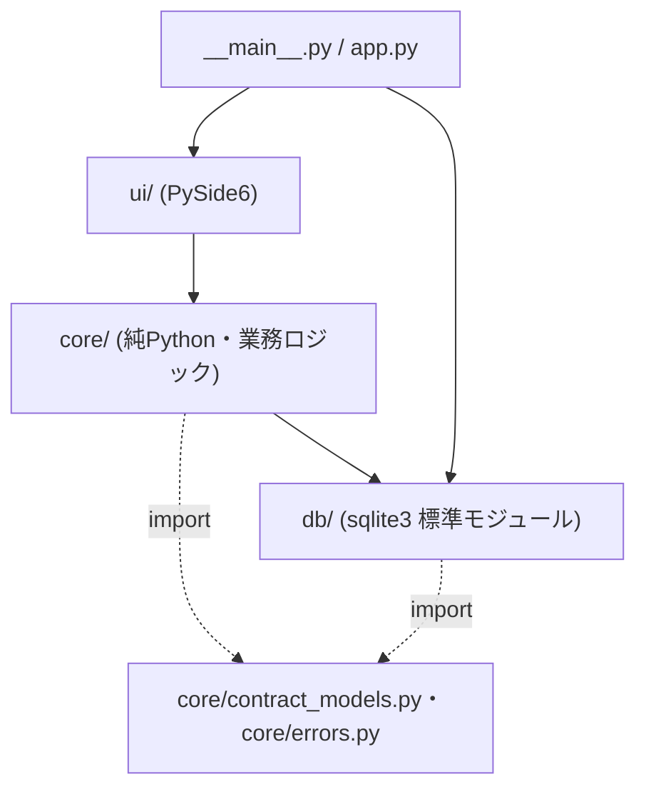
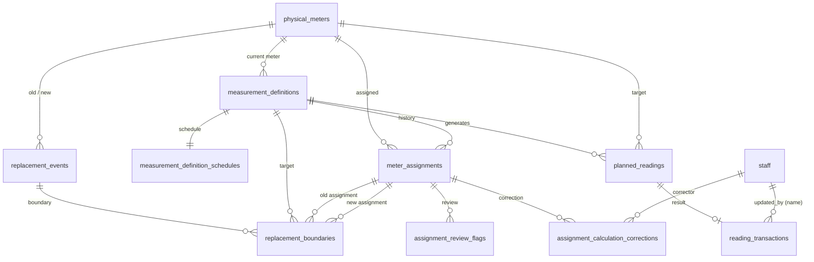

# 検針管理アプリ 開発計画書(基本設計)

- 作成日: 2026-10-20
- ステータス: 基本設計ドラフト(アーキテクチャ再編版)
- 参考文書:
  - [オフライン対応・Wi-Fi同期型_検針システム企画書_v4.md](archive/オフライン対応・Wi-Fi同期型_検針システム企画書_v4.md)(旧サーバー・Android 構成の企画記録。変更しない)
  - 参考: ローカル在庫管理アプリの開発計画書(共通基盤・スマホ HTML 連携・配布構成の設計基準)
- 位置付け: 旧企画書の業務要件・計算ルール(三層分離・Decimal 文字列・ロールオーバー・メーター交換境界・予定枠ライフサイクル・後続再計算)をすべて引き継ぎつつ、保守性の高い「ローカル PySide6 デスクトップアプリ ＋ 自己完結型単一 HTML(Quick Share 送受信)」構成へ再設計した正本。旧企画書と本書の記載が異なる場合は本書を正とする
- 将来統合方針: 備品在庫管理アプリ(`inventory-manager-mini`)および業務日誌アプリと将来的に 1 つの「設備管理アプリ」へ統合できるよう、技術スタック・層構成・DB 接続規約(`sqlite3` 標準モジュール)・バックアップ基盤・スマホ HTML エンベロープ規格を共通化する

---

## 1. 概要・スコープ

### 1.1 目的

施設内の電気・ガス・水道・ボイラー等のメーター検針業務をデジタル化し、ヒューマンエラーの削減と「料金試算・日常運用の根拠となる精緻なデータ集計」を自動化する。
ローカル PC サーバー(FastAPI/uvicorn/mDNS)やネイティブ Android アプリ(Kotlin/Jetpack Compose)の保守管理コストを排し、PC 上の管理・集計はローカルで完結する PySide6 デスクトップアプリとして実現する。現場のスマホ検針は、PC で出力した自己完結型の単一 HTML ファイルを Quick Share 等でスマホへ渡して Chrome で入力し、結果テキストまたは JSON ファイルを PC へ戻す方式で実現する。

### 1.2 MVP スコープ

| 区分 | 対象 |
| --- | --- |
| 対象 | 物理メーター管理、測定定義(`measurement_definitions`)・スケジュール管理、担当者(`staff`)マスタ管理、検針予定枠(`planned_readings`)の自動生成(backfill 含む)・締め処理(`auto_closed`)、スマホ検針(単一 HTML シート出力・Quick Share 送受信・差分プレビュー・一括確定)、PC 上での直接検針入力・訂正、メーター交換登録と交換境界差分計算、後続実測値の連鎖再計算、日次・月次使用量集計・グラフ表示(QtCharts)、CSV エクスポート、手動バックアップ・復元、多重起動防止、Windows インストーラー |
| 対象外 | ローカル HTTP サーバー(FastAPI / uvicorn)、mDNS 探索(zeroconf)、ネイティブ Android アプリ、Bearer トークン認証・QR コードペアリング、`active_device_id` による端末ロック、臨時検針枠(`ad_hoc`)、複数 PC からの同時 DB 編集 |

### 1.3 用語

| 用語 | 定義 |
| --- | --- |
| ロケーション(`location_id`) | 論理的な設置場所(例: 引込電力量計、ホテル厨房動力盤)。物理メーター交換時も変わらない集計の不変キー |
| 物理メーター(`meter_id`) | 実際の計器デバイス。故障や検定満了により交換される対象 |
| 測定定義(`measurement_definition_id`) | 「どの場所の・どの項目を・どの単位・倍率・計算方式・頻度で読むか」を表す論理的な測定対象。予定枠生成と差分計算の単位 |
| 検針目的(`purpose`) | 測定定義の用途区分(`operational`: 日常運用、`billing`: 費用按分根拠、`audit`: 監査・検証用)。同一メーターの二重計上を防ぐ集計フィルタに使用 |
| 検針予定枠(`planned_reading`) | 測定定義と業務日付(`business_date`)・検針枠(`reading_session`)から事前生成される 1 回分の検針タスク |
| 予定枠状態(`task_state`) | 予定枠のライフサイクル(`open`: 未消化、`completed`: 検針完了、`auto_closed`: 締め時刻経過による自動クローズ、`superseded`: メーター交換等による差し替え済み) |
| 検針結果状態(`result_status`) | 予定枠に対する現場の結果(`measured`: 実測、`skipped`: 見送り、`unreachable`: 検針不能、`meter_fault`: 計器不良、`replaced`: 交換済) |
| 使用量差分(`usage_delta`) | 前回実測値(`last_reading`)と今回実測値(`raw_reading`)の差に倍率(`multiplier`)を乗じた値。ロールオーバー補正を含む |
| 交換境界(`replacement_boundary`) | メーター交換時に測定定義ごとの旧メーター最終読値・使用量(`old_meter_usage_delta`)と新メーター初期基準値(`new_initial_reading`)を保持するレコード |
| スマホ検針シート | 対象期間の予定枠とマスタ情報を内包した自己完結型単一 HTML ファイル |
| 担当者(`staff`) | PC 上での操作者および検針結果の確定・入力担当者 |

### 1.4 前提・制約

| 項目 | 内容 |
| --- | --- |
| 利用形態 | ローカルスタンドアロン。単一 PC・単一プロセスで運用し、スマホへは単一 HTML ファイルを Quick Share 等で受け渡す |
| 技術スタック | Python 3.13 / SQLite(`sqlite3` 標準モジュール) / PySide6 |
| 小数計算 | 浮動小数点(`float`)は使用禁止。Python 内は `decimal.Decimal`、SQLite 保存および JSON 入出力は plain decimal 文字列(`TEXT`)とする |
| ネットワーク | 完全オフラインで全機能が動作すること(外部通信は一切行わない) |
| 対象 OS | PC: Windows 10 以上(Inno Setup でインストーラーを作成)、Linux(Python 環境を構築して実行) / スマホ: Android(Chrome) |
| 画面解像度 | PC: 1366×768 以上(文字サイズ 150% でも画面内に収まること) |
| 時刻と業務日付 | DB の時刻列(`recorded_at`、`scheduled_at`、`replaced_at` 等)は UTC で保存し、予定生成・締め判定・集計はローカルタイムゾーン基準の `business_date`(`YYYY-MM-DD`)と `reading_session`(`HH:MM`)で行う |

---

## 2. 開発環境・ツールチェーン

在庫管理アプリの開発計画書 2 章と同一のツールチェーンを採用する。

| 項目 | 選択 | 理由 |
| --- | --- | --- |
| Python | 3.13(`requires-python = ">=3.13"`) | 在庫管理アプリと統一 |
| パッケージ管理 | uv(`pyproject.toml` + `uv.lock`) | 高速・再現性担保 |
| ビルドバックエンド | hatchling(`src/` レイアウト) | 在庫管理アプリと統一 |
| 主要依存 | PySide6、platformdirs、pydantic(データ契約・JSON 検証用) | HTTP/Web 系依存(FastAPI, uvicorn, zeroconf, argon2, segno, SQLAlchemy, Alembic)を廃止し軽量化 |
| 開発依存 | pytest、pytest-qt、pytest-cov、Playwright(単一 HTML 検針シートの自動テスト)、ruff、pyright、pyinstaller、tzdata | 在庫管理アプリと同一の品質ゲート |
| DB アクセス | `sqlite3` 標準モジュール | 単一ユーザーで ORM は不要。`sqlite3.Connection.backup()` と `PRAGMA user_version` による堅牢なバックアップ・復元・マイグレーションを在庫管理アプリと共通化できる |

---

## 3. アーキテクチャと将来統合設計

### 3.1 層構成と依存方向



- 業務処理の呼び出し方向は `ui → core の Service → db` の一方向とする
- `core/` と `db/` は PySide6 を import しない(静的検査・依存ルールのテストで担保)
- `core/` の既存サービス群(`WorkPackageDownloadService`、`MeterReadingSyncService`、`ReadingWriteOrchestrationService`、`UsageDeltaCalculationService`、`MeterMasterService` 等)は `core/meter_reading_sync_repositories.py` の `Protocol` 群を介して `db/repositories.py` を呼び出す
- Repository Protocol・データ型・入出力レコードは `core/contract_models.py` および `core/meter_reading_sync_repositories.py` に置き、Service から独立させる。契約から Service・UI・DB 実装への依存を持たせない
- 公開業務操作の Service がトランザクション境界を持つ。1 つの業務操作 = `with transaction(conn):` (`BEGIN IMMEDIATE`)による 1 トランザクションとし、共通処理と Repository はトランザクションを開始しない
- 起動時は DB オープン・マイグレーション後に `QApplication` と表示設定を初期化し、既定設定投入・予定枠補完・自動クローズを統括する Service を実行してから MainWindow を表示する。準備失敗時は処理をロールバックし、ログ記録と汎用エラー通知を行って `STARTUP_FAILURE` とし、MainWindow を表示しない

### 3.2 将来の「設備管理アプリ」統合を見据えたモジュール構成

将来的に「備品在庫管理(`inventory`)」「検針管理(`meter_reading`)」「業務日誌(`work_log`)」を 1 つの PySide6 アプリケーションへ統合する際、そのままサブパッケージとして合流できる構成とする。

```text
meter-reading-app/
├─ pyproject.toml / uv.lock
├─ docs/
│  └─ plan/
│     └─ ローカル検針管理アプリ開発計画書.md  # 本書
├─ src/meter_reading_mini/
│  ├─ __main__.py
│  ├─ app.py                                # 起動シーケンス・自動クローズ・当日予定生成
│  ├─ config.py                             # パス解決(platformdirs)
│  ├─ core/
│  │  ├─ contract_models.py                 # 語彙 StrEnum・Decimal 文字列シリアライズ・DTO
│  │  ├─ errors.py                          # DomainError 基底と業務例外
│  │  ├─ meter_reading_sync_repositories.py # Repository Protocol と入出力レコード定義
│  │  ├─ usage_delta_calculation.py         # 差分計算・ロールオーバー補正(純関数)
│  │  ├─ reading_write_orchestration.py     # 保存前履歴照合・交換境界適用・後続再計算
│  │  ├─ meter_reading_sync.py              # 検針結果・交換イベントの一括 Upsert
│  │  ├─ work_package_download.py           # 予定枠 backfill 生成・auto_closed・グループ化
│  │  ├─ meter_master_service.py            # 物理メーター・測定定義 CRUD
│  │  ├─ schedule_settings.py               # スケジュール設定・締め時刻設定サービス
│  │  ├─ timezone_settings.py               # タイムゾーン・業務日付算出
│  │  ├─ reading_signature.py               # 監査用 SHA-256 署名計算
│  │  ├─ mobile_reading.py                  # 単一 HTML 検針シート生成・MR1 結果テキスト/JSON 解析
│  │  └─ reports.py                         # 期間集計・CSV エクスポート
│  ├─ db/
│  │  ├─ connection.py                      # sqlite3 接続(autocommit=True)・PRAGMA・transaction()
│  │  ├─ schema.sql                         # 最新 DDL
│  │  ├─ migrations.py                      # SCHEMA_VERSION・版別スキーマ検査・移行
│  │  ├─ repositories.py                    # 標準 sqlite3 による Repository Protocol 実装
│  │  ├─ bootstrap_seeds.py                 # 初期マスタ・設定 seed データ
│  │  ├─ integrity.py                       # 復元・移行時の業務整合性検査
│  │  └─ backup.py                          # バックアップ・復元
│  └─ ui/
│     ├─ single_instance.py                 # 多重起動防止(QLockFile)
│     ├─ display_settings.py                # フォント・文字サイズ設定(ui_settings.json)
│     ├─ main_window.py                     # 予定枠・検針結果一覧・フィルタ・操作導線
│     ├─ dialogs/                           # スマホ検針・PC直接入力・メーター交換・マスタ・設定
│     └─ widgets/                           # 集計ダッシュボード(QtCharts)
└─ tests/
```

---

## 4. DB 基本設計(標準 `sqlite3`)

### 4.1 ER 図



### 4.2 スキーマ(`db/schema.sql`)

在庫管理アプリのテーブル群(`items`, `stock_movements`, `stock_allocations`, `categories`, `locations`, `clients`, `purchasers`, `settings`)と同一 SQLite ファイルに同居しても名前が衝突しないよう、検針設定テーブルは `meter_app_settings` とし、担当者テーブル `staff` は在庫管理アプリと同一スキーマとする。

```sql
CREATE TABLE staff (
  id INTEGER PRIMARY KEY,
  name TEXT NOT NULL UNIQUE,
  is_active INTEGER NOT NULL DEFAULT 1 CHECK (is_active IN (0, 1))
);

CREATE TABLE physical_meters (
  meter_id TEXT PRIMARY KEY,
  location_id TEXT NOT NULL,
  location_name TEXT NOT NULL,
  meter_name TEXT NOT NULL,
  category TEXT NOT NULL CHECK (category IN ('electricity','gas','water','boiler','others')),
  meter_serial TEXT,
  is_active INTEGER NOT NULL DEFAULT 1 CHECK (is_active IN (0, 1))
);
CREATE INDEX idx_physical_meters_location ON physical_meters(location_id);

CREATE TABLE measurement_definitions (
  measurement_definition_id TEXT PRIMARY KEY,
  location_id TEXT NOT NULL,
  meter_id TEXT REFERENCES physical_meters(meter_id),
  display_name TEXT NOT NULL,
  category TEXT NOT NULL CHECK (category IN ('electricity','gas','water','boiler','others')),
  unit TEXT NOT NULL,
  value_schema TEXT NOT NULL CHECK (value_schema IN ('decimal_string','power_factor_percent_phase')),
  multiplier TEXT NOT NULL,
  decimal_places INTEGER CHECK (decimal_places IS NULL OR (typeof(decimal_places) = 'integer' AND decimal_places BETWEEN 0 AND 10)),
  warning_threshold TEXT,
  rollover_value TEXT,
  calculation_method TEXT NOT NULL CHECK (calculation_method IN ('delta','raw_only')),
  reading_cycle TEXT NOT NULL CHECK (
    reading_cycle IN ('daily_1x','daily_2x','daily_3x','weekly','monthly','every_two_months')
  ),
  purpose TEXT NOT NULL DEFAULT 'operational' CHECK (purpose IN ('operational','billing','audit')),
  generation_start_date TEXT NOT NULL,
  is_active INTEGER NOT NULL DEFAULT 1 CHECK (is_active IN (0, 1))
);
CREATE INDEX idx_measurement_defs_location ON measurement_definitions(location_id);

CREATE TABLE measurement_definition_schedules (
  measurement_definition_id TEXT NOT NULL
    REFERENCES measurement_definitions(measurement_definition_id),
  effective_from_date TEXT NOT NULL,
  schedule_json TEXT,
  created_at TEXT NOT NULL,
  PRIMARY KEY (measurement_definition_id, effective_from_date)
);

CREATE TABLE reading_cycle_schedule_defaults (
  reading_cycle TEXT NOT NULL CHECK (
    reading_cycle IN ('daily_1x','daily_2x','daily_3x','weekly','monthly','every_two_months')
  ),
  effective_from_date TEXT NOT NULL,
  schedule_json TEXT NOT NULL,
  created_at TEXT NOT NULL,
  PRIMARY KEY (reading_cycle, effective_from_date)
);

CREATE TABLE reading_session_release_offsets (
  reading_session TEXT NOT NULL CHECK (
    reading_session IN ('00:00','06:00','08:00','14:00','17:00','22:00')
  ),
  effective_from_date TEXT NOT NULL,
  offset_days INTEGER NOT NULL CHECK (typeof(offset_days) = 'integer'),
  created_at TEXT NOT NULL,
  PRIMARY KEY (reading_session, effective_from_date)
);

CREATE TABLE meter_assignments (
  measurement_definition_id TEXT NOT NULL
    REFERENCES measurement_definitions(measurement_definition_id),
  meter_id TEXT NOT NULL REFERENCES physical_meters(meter_id),
  effective_from TEXT NOT NULL,
  effective_to TEXT,
  multiplier TEXT NOT NULL CHECK (length(multiplier) > 0),
  rollover_value TEXT CHECK (rollover_value IS NULL OR length(rollover_value) > 0),
  CHECK (effective_to IS NULL OR effective_from < effective_to),
  PRIMARY KEY (measurement_definition_id, meter_id, effective_from)
);

CREATE TABLE assignment_review_flags (
  measurement_definition_id TEXT NOT NULL,
  meter_id TEXT NOT NULL,
  assignment_effective_from TEXT NOT NULL,
  reason TEXT NOT NULL CHECK (length(trim(reason)) > 0),
  created_at TEXT NOT NULL,
  FOREIGN KEY (measurement_definition_id, meter_id, assignment_effective_from)
    REFERENCES meter_assignments(measurement_definition_id, meter_id, effective_from),
  PRIMARY KEY (measurement_definition_id, meter_id, assignment_effective_from)
);

CREATE TABLE assignment_calculation_corrections (
  correction_id TEXT PRIMARY KEY,
  measurement_definition_id TEXT NOT NULL,
  meter_id TEXT NOT NULL,
  assignment_effective_from TEXT NOT NULL,
  old_multiplier TEXT NOT NULL CHECK (length(old_multiplier) > 0),
  old_rollover_value TEXT CHECK (old_rollover_value IS NULL OR length(old_rollover_value) > 0),
  new_multiplier TEXT NOT NULL CHECK (length(new_multiplier) > 0),
  new_rollover_value TEXT CHECK (new_rollover_value IS NULL OR length(new_rollover_value) > 0),
  staff_id INTEGER NOT NULL REFERENCES staff(id),
  staff_name TEXT NOT NULL CHECK (length(trim(staff_name)) > 0),
  corrected_at TEXT NOT NULL,
  reason TEXT NOT NULL CHECK (length(trim(reason)) > 0),
  FOREIGN KEY (measurement_definition_id, meter_id, assignment_effective_from)
    REFERENCES meter_assignments(measurement_definition_id, meter_id, effective_from)
);
CREATE INDEX idx_assignment_calculation_corrections_assignment
  ON assignment_calculation_corrections(
    measurement_definition_id, meter_id, assignment_effective_from, corrected_at
  );

CREATE TABLE planned_readings (
  planned_reading_id TEXT PRIMARY KEY,
  measurement_definition_id TEXT NOT NULL
    REFERENCES measurement_definitions(measurement_definition_id),
  meter_id TEXT NOT NULL REFERENCES physical_meters(meter_id),
  location_id TEXT NOT NULL,
  business_date TEXT NOT NULL,
  release_date TEXT NOT NULL,
  reading_session TEXT NOT NULL,
  scheduled_at TEXT NOT NULL,
  task_state TEXT NOT NULL DEFAULT 'open' CHECK (
    task_state IN ('open','completed','auto_closed','superseded')
  ),
  closed_at TEXT,
  close_reason TEXT CHECK (
    close_reason IS NULL OR close_reason IN (
      'cutoff_elapsed','meter_replaced','schedule_recomposed','definition_deactivated'
    )
  ),
  superseded_by_planned_reading_id TEXT REFERENCES planned_readings(planned_reading_id)
);
CREATE INDEX idx_planned_readings_def_sched
  ON planned_readings(measurement_definition_id, scheduled_at, planned_reading_id);
CREATE INDEX idx_planned_readings_business_date ON planned_readings(business_date);
CREATE INDEX idx_planned_readings_release_date ON planned_readings(release_date);

CREATE TABLE reading_transactions (
  planned_reading_id TEXT PRIMARY KEY
    REFERENCES planned_readings(planned_reading_id),
  result_status TEXT NOT NULL CHECK (
    result_status IN ('measured','skipped','unreachable','meter_fault','replaced')
  ),
  recorded_at TEXT NOT NULL,
  client_updated_at TEXT NOT NULL,
  raw_reading TEXT,
  last_reading TEXT,
  usage_delta TEXT,
  structured_payload_json TEXT,
  device_id TEXT NOT NULL DEFAULT '',
  updated_by TEXT NOT NULL,
  signature TEXT NOT NULL,
  note TEXT,
  result_source TEXT NOT NULL CHECK (result_source IN ('mobile_html','manual')),
  arrival_sequence INTEGER NOT NULL DEFAULT 1
);

CREATE TABLE replacement_events (
  replacement_event_id TEXT PRIMARY KEY,
  location_id TEXT NOT NULL,
  old_meter_id TEXT NOT NULL REFERENCES physical_meters(meter_id),
  new_meter_id TEXT NOT NULL REFERENCES physical_meters(meter_id),
  replaced_at TEXT NOT NULL,
  -- 旧読値列は互換のため残すが NULL 固定。読値の正本は交換境界とする。
  old_final_reading TEXT,
  new_initial_reading TEXT,
  client_updated_at TEXT NOT NULL,
  updated_by TEXT NOT NULL,
  note TEXT,
  arrival_sequence INTEGER NOT NULL DEFAULT 1
);
CREATE INDEX idx_replacement_events_location ON replacement_events(location_id);

CREATE TABLE replacement_boundaries (
  replacement_event_id TEXT NOT NULL REFERENCES replacement_events(replacement_event_id),
  measurement_definition_id TEXT NOT NULL
    REFERENCES measurement_definitions(measurement_definition_id),
  location_id TEXT NOT NULL,
  business_date TEXT NOT NULL,
  old_meter_id TEXT NOT NULL REFERENCES physical_meters(meter_id),
  new_meter_id TEXT NOT NULL REFERENCES physical_meters(meter_id),
  replaced_at TEXT NOT NULL,
  old_assignment_effective_from TEXT NOT NULL,
  new_assignment_effective_from TEXT NOT NULL,
  previous_measured_reading TEXT,
  previous_measured_planned_reading_id TEXT,
  old_final_reading TEXT,
  old_meter_usage_delta TEXT,
  new_initial_reading TEXT,
  created_at TEXT NOT NULL,
  updated_at TEXT NOT NULL,
  PRIMARY KEY (replacement_event_id, measurement_definition_id)
);

CREATE TABLE meter_app_settings (
  setting_key TEXT PRIMARY KEY,
  setting_value TEXT NOT NULL,
  updated_at TEXT NOT NULL
);
```

現行スキーマは `SCHEMA_VERSION = 3` である。v1 から v2 への移行では割当ごとの計算条件を追加し、旧測定定義の倍率・ロールオーバー値を各割当へ初期値として複写する。過去の正しい条件を復元したものとはみなさず、既存の読値・使用量も自動再計算しない。境界と割当を一意に対応付けられない等の事前検査エラーがあれば移行全体を拒否する。v2 から v3 への移行では条件確認待ちを記録し、交換読値を測定定義別の `replacement_boundaries` に一本化する。

旧読値と引き継いだ条件が矛盾する割当には `assignment_review_flags` を作成し、理由を表示する。確認待ち割当は通常の入力・計算に使わず、「マスタ管理 → 計算条件の訂正」で当時の正しい割当条件を担当者・理由付きで訂正する。訂正後に対象値・後続値を再検証・再計算し、正常に解消した場合に確認待ちを解除する。移行による DB の自動初期化・削除や既存使用量の一括変更は行わない。同じ `user_version` でも版別スキーマ検査に合わない DB は拒否する。周期別スケジュールと検針時間別配信オフセットの初版は `effective_from_date = '0001-01-01'` で冪等に投入し、`meter_app_settings` には締め時刻と業務タイムゾーンを保存する。

---

## 5. 業務ルール

### 5.1 コア計算・データ整合性ルール(既存仕様の継承)

1. **三層分離**: `location_id`(集計場所)、`meter_id`(物理計器)、`measurement_definition_id`(論理測定対象)を分離する。同一ロケーションに複数の測定対象(積算電力量、最大需要電力、力率等)を持てる。
2. **浮動小数点の排除と丸めなし計算**: すべての測定値・倍率・閾値・ロールオーバー値・使用量差分は `decimal.Decimal` で計算し、DB・JSON では有限の plain decimal 文字列として保持する。演算ごとに対象値の整数部・小数部の桁数と桁上がりから必要精度を求めた局所 Decimal コンテキストを使い、減算・ロールオーバー補正・乗算の途中を含めて丸めない。グローバルな Decimal 精度は変更せず、入力範囲を狭める総桁数上限も設けない。加減算の結果スケールは両辺の小数桁数の最大、乗算の結果スケールは両辺の小数桁数の和とする。ブラウザ側の業務計算も `Number` / `parseFloat` を使わず、文字列と BigInt による固定小数点演算で一致させる。
   - `decimal_places` は新規・訂正入力の検証と表示形式に適用する。桁数変更時も、保存済み読値・交換境界・使用量を切り捨てたり 0 埋めしたりして書き換えず、既存値の精度を理由に再計算・復元を拒否しない。画面では過去値を変換しないことを明示する。新しい桁数で表せないロールオーバー値への変更は拒否する。
3. **ロールオーバー補正と差分計算(`UsageDeltaCalculationService`)**:
   - `calculation_method = 'raw_only'` の場合は `usage_delta = None` とする。
   - `calculation_method = 'delta'` かつ `value_schema = 'decimal_string'` の場合は、直前の実測値(`last_reading`)との差分に `multiplier` を乗じて `usage_delta` を算出する。
   - `raw_reading < last_reading` のとき、`rollover_value` が設定されていれば `(rollover_value - last_reading + raw_reading) * multiplier` で補正し、未設定であれば負の差分を異常値として拒否する。
4. **予定枠の自動生成と自動クローズ(`WorkPackageDownloadService`)**:
   - 測定定義の予定生成開始業務日から対象業務日までを包含して照合し、有効な測定定義について不足枠だけを生成する。開始日は新規登録時の既定を業務日の当日とし、過去から運用する場合は明示指定する。メーター交換では開始日をリセットしない。
   - `measurement_definition_schedules`、`reading_cycle_schedule_defaults`、`reading_session_release_offsets` の適用履歴を日付ごとに解決し、適用期間は次の版の開始日までの半開区間とする。周期別既定より測定定義別の設定を優先し、設定変更を過去の期間へ遡及適用しない。変更の適用開始日は既定を現在業務日とし、過去日の指定は拒否する。同一適用開始日の再保存は履歴行を上書きする。
   - 予定枠の不足は測定定義・業務日・検針時間の論理キーで判定する。予定日時に有効な割当期間 `[effective_from, effective_to)` から物理メーターを解決し、履歴の不足・重複を現在値で推測せず業務エラーとして通知する。交換後の代替枠を重複生成せず、通常の補完で既存枠・結果を変更したり `superseded` を復活させたりしない。
   - 補完は起動時および検針シート出力時に対象業務日まで完了させる。14 日は内部の走査単位に限り、生成 0 件の期間でも日付で進める。`backfill_pending` の状態を成功として返さない。設定変更時の再構成は現在有効な後継枠を対象とし、交換済み・無効化済み・`auto_closed` の枠を `open` に戻さない。
   - `meter_app_settings` の業務タイムゾーンを基準とし、締め時刻(`cutoff_time`、初期値 `07:00`)経過後、前日以前の `open` 枠を `auto_closed` にする。補完と自動クローズは同一トランザクションで実行し、締め判定には出力対象日でなく注入した時計の現在業務日時を使う。
   - `auto_closed` となった予定枠に対しても、後からスマホ検針結果または PC 直接入力が届いた場合は現場入力を優先して `completed` に更新し、`usage_delta` を再計算する。
   - 予定枠の完了 (`task_state`) と結果状態 (`result_status`) は別管理とする。実測 (`measured`) に限らず、見送り (`skipped`)・検針不能 / 到達不能 (`unreachable`)・計器不良 / 計器故障 (`meter_fault`) の結果保存でも、`open` / `auto_closed` を `completed` にする。非実測結果を未完了として残したり、再検針のために自動で `open` へ戻したりしない。
5. **後続実測値の連鎖再計算(`ReadingWriteOrchestrationService`)**:
   - 過去枠の追加入力や訂正により実測値が確定・変更された場合、または実測と非実測を相互変更した場合、`scheduled_at, planned_reading_id` 順で後続する同一測定定義の実測レコードを探索し、`last_reading` と `usage_delta` を連鎖的に再計算して更新する。
6. **メーター交換(`ReplacementEvent` / `ReplacementBoundary`)**:
   - 旧最終読値・新初期読値は測定定義ごとに保持する。`replacement_boundaries` が読値の正本であり、`replacement_events` の旧読値列は互換のため残すが NULL とする。境界には旧・新の割当開始日時を記録し、それぞれの条件を一意に解決する。旧メーターの最終読値から各境界の使用量(`old_meter_usage_delta`)を確定し、新メーター初回実測時は `new_initial_reading` を `last_reading` として使用する(`new_initial_reading` が未指定の場合のみ初回 `usage_delta = 0`)。
   - `old_meter_usage_delta` にも倍率・ロールオーバー補正を適用し、ロールオーバー未設定で負の差分となる場合は拒否する。交換をまたいで旧メーターの読値を新メーターの前回値にしない。
   - 過去の訂正では交換境界の `previous_measured_reading`・参照先・`old_meter_usage_delta` も再計算する。新初回の訂正・非実測化では、交換初期値を次に初回となる実測へ適用し、自身を境界消費済みと誤判定しない。
   - 交換日時以降の旧メーターの `open` / `auto_closed` 枠は、新メーター向けの後継枠を作成してから `superseded` に変更する。`completed` の非実測結果(`skipped` / `unreachable` / `meter_fault`)は旧枠に結果を保持したまま差し替える。`measured` 結果が残る場合は交換を拒否し、利用者による明示的な非実測訂正を求める。結果欠落・状態不整合・関係を特定できない `replaced` 結果も拒否する。後継枠へ旧結果をコピーせず、旧枠への以後の入力を拒否する。旧メーターは交換時に自動無効化しない。
7. **旧データの確認警告**: 移行時に旧読値と引き継いだ割当条件の矛盾が見つかった割当は確認待ちにし、条件訂正で解消するまで利用を止める。復元時はこの状態と同一 `location_id` 内の場所名不一致を業務整合性エラーと分けて警告表示し、利用者が条件訂正・場所名一括変更で修復できるようにする。
7. **時刻・業務タイムゾーン**: DB 時刻文字列は UTC の `YYYY-MM-DD HH:MM:SS` (秒単位)に正規化する。タイムゾーンは `meter_app_settings` の `app.timezone.v1` (既定 `Asia/Tokyo`)に統一し、`timeutil` には必ず明示して渡す。`planned_readings` が 1 件でも存在する場合の値変更は拒否し、初回設定と同じ値の再保存は許可する。
8. **トランザクションと一括確定**: 公開業務操作の Service がトランザクションを所有し、Repository と共通処理は開始しない。設定保存では適用履歴の更新と影響する予定枠の再構成を同一トランザクションで行う。スマホ結果の一括確定では全体を 1 トランザクションとし、結果 1 件ごとに SAVEPOINT を置く。`DomainError` 派生の業務拒否だけを当該 SAVEPOINT まで戻して拒否として集計し、署名・交換境界・予定枠更新・後続再計算をその SAVEPOINT に含める。予期しない例外や COMMIT 失敗は全体をロールバックして再送出する。
9. **入力の新旧と重複**: `client_updated_at` の古さによる無視はスマホ取込だけに適用する。同時刻では `arrival_sequence` を進めて後着入力を採用する。`client_updated_at` と `recorded_at` がともに正規化後同値で、結果状態・測定値・構造化入力・備考も既存結果と一致する再取込は、順序・署名・再計算を含め何も更新せず重複として集計する。PC 直接入力・訂正は常に採用し、`client_updated_at` は注入した時計の現在時刻と既存値 + 1 秒の遅い方とする。
   - 上記は業務検証を通る入力の採否規則であり、PC の実測・非実測結果を永久に優先するロックではない。シート出力後に PC で実測・検針不能・計器不良等を登録しても、既存 HTML へは自動反映しない。そのシートからの取込は `completed` という理由だけでは拒否せず、保存済み結果より更新時刻が古ければ除外、新しければ上書き、同時刻なら重複判定後に後着を採用する。`superseded` の旧枠への入力は別途拒否する。
   - 比較基準は HTML 出力時刻・PC への取込時刻・`recorded_at` ではなく、UTC 秒単位に正規化した `client_updated_at` とする。スマホでは入力編集・確認操作でも更新されるため、端末の時計ずれは採否に影響する。使用量はスマホの参考値ではなく PC の最新 DB から再計算し、プレビュー後に関連状態が変われば確定せず再プレビューを求める。
10. **監査情報と署名**: `result_source` は `mobile_html` / `manual` のみとする。スマホ結果は `device_id = sheet_id`、PC 直接入力・訂正は `device_id = 'pc-direct'`、いずれも `updated_by` に確定・入力担当者名を記録する。署名は PC の確定時に生成し、スマホ側署名は検証しない。署名の元文字列は `planned_reading_id|result_status|payload|recorded_at|device_id`、`recorded_at` は UTC 秒単位の正規化形式とする。署名が検出するのは予定枠・結果状態・測定値・記録日時・`device_id` の改ざんに限り、`updated_by`・`note`・`usage_delta` は対象外で、送信者認証ではない。後続再計算で `result_source`・署名・`updated_by` を変更しない。
11. **マスタ保護と測定定義**: マスタは物理削除せず論理削除する。有効な測定定義に割当中、または `open` 予定枠を持つ物理メーターの無効化は拒否する。`auto_closed` 枠だけの場合は拒否せず、無効化済みメーターの既存枠(`auto_closed` を含む)への後日入力・訂正は許可する。無効化済みマスタは新規割当・交換先指定・新規枠生成に利用できない。測定定義・初期割当の登録時は生成開始日・初期履歴・割当を原子的に保存する。測定定義の `reading_cycle`・`value_schema`・`calculation_method`・`location_id` は作成後に変更できず、変更する場合は旧定義を無効化して新規作成する。測定定義を無効化すると現在業務日以降の `open` 枠だけを `superseded` (`close_reason = 'definition_deactivated'`)にし、`completed`・`auto_closed` 枠と結果は変更しない。再有効化しても枠を復活させず、無効期間を補完しない。生成開始日は `max(既存値, 現在業務日)` とする。
12. **廃止仕様と起動失敗**: 臨時検針枠(`ad_hoc`)は設けない。起動時準備が失敗した場合は全体をロールバックしてログ記録し、`QApplication` が有効な状態で汎用エラーを通知して `STARTUP_FAILURE` とし、MainWindow を表示しない。

### 5.2 スマホ検針(単一 HTML ＋ Quick Share 方式)

在庫管理アプリのスマホ棚卸アーキテクチャを踏襲しつつ、検針業務向けに以下のルールとする。

#### 5.2.1 検針シート HTML の出力(PC → スマホ)

- **配布単位と出力対象フィルタ**:
  - 既定は「対象業務日(既定は当日)の 1 日分すべて(日次全枠 ＋ 該当日の週次・月次・隔月枠)」を 1 つの単一 HTML ファイルとして出力する。
  - ただし、「時間帯ごとに別担当者が別端末で回る」「午前分を PC に確定反映した後に午後分だけ最新状態で出力したい」といった運用にも対応できるよう、出力時に特定の検針枠(`reading_session`: `08:00`、`14:00`、`22:00` 等)または周期区分に絞って出力するオプションを提供する。
  - 周期区分の値は `daily`(日次の `daily_1x` / `daily_2x` / `daily_3x` を束ねる)・`weekly`・`monthly`・`every_two_months` とする。検針時間と周期区分はそれぞれ複数選択でき、指定がない条件は全件を意味する。
  - ファイル名は全枠が `meter_reading_YYYYMMDD_HHMMSS.html`、単一検針時間が `meter_reading_YYYYMMDD_0800_HHMMSS.html`、単一周期区分が `meter_reading_YYYYMMDD_weekly_HHMMSS.html` 等、複数条件が `meter_reading_YYYYMMDD_filtered_HHMMSS.html` とする。日付は対象業務日、時刻は出力時の業務タイムゾーンによるローカル時刻とする。
- PC で選択する業務日の初期値は現在業務日とし、未来日を選択できない。シート出力時に担当者の選択は不要とし、結果の確定時に有効な担当者を選択する。
- HTML は保存先と同じフォルダーの一時ファイルへの書込が完了してから置換する。保存先フォルダーの記憶はアプリ起動中のみとし、成功時は保存先・出力枠数と Quick Share・Chrome の利用手順を通知する。シート生成処理の呼出し後は、空シート・保存失敗・保存先選択キャンセルを含め、DB が変更され得る場合に予定枠の再読込を通知する。
- 出力対象は指定された `business_date` の `open`・`auto_closed` の予定枠とし、`release_date` は絞り込みに使わない。`completed`・`superseded` の枠は出力しない。対象枠が参照する測定定義・物理メーター(`meter_name`・`meter_serial` を含む)・場所名は、各マスタが論理削除済みでも欠落させない。
  - 現在業務日以前を指定できるが、指定日以外の過去の未完了枠をまとめて収録しない。過去日の `auto_closed` も出力・後日入力の対象とする。
  - 見送り・検針不能 / 到達不能・計器不良 / 計器故障を登録済みの枠も `completed` のため、新規シートには再掲載しない。再検針後は PC 直接入力・訂正で実測へ変更できる。完了前に出力済みのシートから戻った結果は、5.1 の「入力の新旧と重複」に従って採否を判定する。
- 検針シートは v1 の JSON データ、CSS、JavaScript を一つの HTML に内包する。データは `kind = "mrm-meter-reading-sheet"`、`v = 1`、32 文字の小文字 16 進数 `sheet_id`、`business_date`、UTC 秒単位の `generated_at`、業務タイムゾーンで表示する `generated_at_local`、出力条件の `filter`、`locations`・`meters`・`definitions`・`slots` を持つ。枠には `planned_reading_id`・`measurement_definition_id`・`meter_id`・検針時間・予定日時・周期・`task_state` と、枠ごとの初期前回値・前回値の出所を含める。HTML 内のデータは `safe_json_for_script` で安全に埋め込み、CSS / JavaScript も含め外部通信を一切行わない。テンプレート資産は `core/mobile_reading_assets/` から読み込み、単一ファイルにまとめる。
- 枠ごとの初期前回値は、同じ測定定義・物理メーターについて対象枠より前にある実測値のうち `scheduled_at, planned_reading_id` 順で直近のものを使い、読値と参照元の予定日時・枠 ID をセットで保持する。交換境界がある場合は `new_initial_reading` を優先し、未指定なら初回使用量 0 とする。前回値の出所は `measured`・`replacement_initial`・`replacement_no_initial`・`none` で区別し、実測値以外では参照元を持たない。予定枠の一覧とこの判定は Service のトランザクション内で行う。
- Android の簡易ビューア(JavaScript 無効環境)で開かれた場合に備え、冒頭に「Chrome で開いてください」の案内を表示する。

#### 5.2.2 スマホ Chrome での入力と途中保存

- **3 段構えのナビゲーション・絞り込み UI(片手操作最適化)**:
  1. **最上部: 検針時間(`reading_session`)・周期の横スクロール・ピルタブ(自動フォーカス付き)**
     - `[すべて] [08:00 (3/12)] [14:00 (0/8)] [22:00 (0/12)] [週次・月次・隔月 (1/5)]` のように、各枠の消化件数バッジ付きピルタブを上部に固定表示する。
     - **初期自動選択**: 日次枠では未消化枠が残る最も早い検針時間のピルタブを選ぶ。日次枠がすべて消化済みで非日次の未消化枠があれば `[週次・月次・隔月]`、すべて消化済みなら `[すべて]` を選ぶ。現在時刻との近さでは選ばない。
  2. **中段: 設置場所(`location_id`)別グルーピングとクイック絞り込みバー**
     - 現場では場所(受変電室、ボイラー室、厨房等)を移動しながら複数メーターをまとめて読むため、リストは `location_id` ごとのセクション見出し(Sticky Header / アコーディオン開閉可)でグループ化して表示する(`location_id` 未設定は末尾の「場所未設定」セクションにまとめる)。
     - セクション内の並び順は `category` 固定順(`electricity` → `gas` → `water` → その他)＋ `display_name` 昇順とする。
     - 画面上部に「設置場所ドロップダウン(特定の場所へ即座に絞り込み/ジャンプ)」と「未入力のみ表示トグル」を配置する。場所内の全項目が入力済みになるとセクション見出しに完了バッジを表示し、ワンタップまたは自動で折りたためるようにする。
  3. **カード内: 連続入力導線**
     - 同一ロケーション内に複数の測定項目がある場合にスクロールの手間を省くため、数値・状態を入力して確定した際に同じ場所の次の未入力項目へフォーカス(またはスクロール位置)を進める「次へ」導線を提供する。
- **入力とローカル即時検証(同日先行枠からの前回値動的引き継ぎを含む)**:
  - 各予定枠に対し、状態(`measured` / `skipped` / `unreachable` / `meter_fault`)を選択できる。
  - `decimal_string` の場合は数値入力欄を表示し、前回値(`last_reading`)・倍率(`multiplier`)・小数桁数(`decimal_places`)・ロールオーバー値(`rollover_value`)から参考使用量を即時計算して画面表示する。
  - **同日先行枠の前回値引き継ぎ**: 対象枠と同じ `measurement_definition_id` かつ同じ `meter_id` のシート内確認済み正常実測値と、シート出力時点の DB 由来初期実測値を候補にする。対象枠より前の候補のうち `scheduled_at, planned_reading_id` 順で最も新しいものを表示上の前回値・参考使用量に使う。交換前後の異なる `meter_id` 間では引き継がない。シートに含まれない `completed` 枠の実測値を、より古いシート内入力で上書きしない。先行枠の測定値・状態・備考が変わって確認が解除されたときは、依存する後続枠の前回値・参考使用量を再計算し、その後続枠の確認も解除する。確認済みの先行実測がなくなれば DB 由来の候補を含め再選択し、それもなければ交換初期値または初回使用量 0 に戻す。
  - 算出した参考使用量が `warning_threshold` を超える場合、または前回値を下回る場合は警告バナーを表示する(現場での実数記録自体は妨げない)。
  - `power_factor_percent_phase` の場合は `%`(0〜100)と位相(`lag` / `lead` / `unity`、`100%` のときは `unity` 自動固定)を入力する。
  - 参考使用量の `raw_only` は `null` とする。差分・ロールオーバー・倍率計算は小数桁数に基づく BigInt 固定小数点演算で丸めずに行う。ロールオーバー未設定の負の差分や閾値超過は警告するが、現場での実数記録を妨げない。初期前回実測がなく `previous_source` が `replacement_no_initial` / `none` の枠は、同日先行実測がない限り初回使用量を 0 とする。
- **自動保存(IndexedDB)と下書き形式**:
  - `localStorage` は使わず、IndexedDB(`mrm_meter_reading`、DB 版数 1、`drafts` ストア)へ `sheet_id` 単位で操作状態を自動保存・復元する。結果状態(`result_status`)・測定値(`raw_reading`)・力率(`%`・位相)・備考(`note`)・確認・確認解除・リセットの変更を保存対象とする。
  - 保存状態を「読込中」「保存中」「保存済み」「保存失敗」で示し、「保存済み」は最新の変更に対応する書込トランザクションの完了を確認した状態を表す。保存完了後の強制終了や電源断まで保証するものではない。
  - 保存データと途中経過 JSON(途中バックアップ)は、種別・版数・`sheet_id`・対象業務日・出力日時・出力対象条件・対象予定枠(`planned_reading_id`・測定定義・初期前回値等)の一致を検証する下書き形式(v1)を使う。空欄・不正な数値・範囲外の力率・長すぎる備考等の入力途中状態も保持・復元するが、業務条件を満たさない予定枠は確認済みにしない(測定値・状態・備考の変更時は確認を解除する)。既存保存データを確認できない場合に初期状態で自動上書きせず、別タブとの保存競合時も自動マージ・上書きを行わない。
  - IndexedDB は `storage_revision` による別タブ競合検出と、同一タブの編集世代・保存完了世代を分けて管理する。保存キューの古い書込が完了しても最新変更を「保存済み」とせず、最新変更の失敗・競合通知も古い書込完了で消さない。
- **途中経過 JSON(途中バックアップ)の保存・読込(フォールバック)**:
  - IndexedDB の保存領域が利用できない場合も、入力内容を維持して警告を表示し、再試行と途中経過 JSON(途中バックアップ)を利用できる。
  - 途中経過 JSON は利用者の明示操作で保存し、未確認・入力途中のエラーも含む。読込時は同じシートのデータであることを検証し、確認後に現在の入力全体を置き換える(自動マージはしない)。読込後は同日先行枠からの前回値動的引き継ぎ・参考使用量・警告表示も再計算して反映する。
  - ファイルとしてダウンロードできない場合は JSON の表示・手動コピーと貼付読込を使う。途中経過 JSON は平文の JSON ファイルであり、利用者が安全に保管し、不要になったら手動で削除する。結果を出力・確定しても自動削除しない。
- **Android 実機での自動復元保証範囲**:
  - 在庫管理アプリの最終実機確認(2026-10-21、moto g66j 5G / Android 16、Chrome 155.0.8059.79 通常モード、Quick Share → Files → Chrome の `content://com.google.android.apps.nbu.files.provider` 経路)と同一の運用前提とする。同じ端末・Chrome・HTML・起動経路では、Chrome 終了後および端末再起動後に自動復元でき、Quick Share からの再取得後も復元できる。HTML を移動した場合は自動復元できず、途中経過 JSON(途中バックアップ)から回復する。
  - 自動復元を保証する範囲は実機で確認したこの条件に限り、Gmail 経由・別ブラウザ・プライベートモード・ファイル移動後の IndexedDB 継続利用は保証しない。保存領域の消去・退避、ブラウザによる消去、容量不足、ブラウザ更新、保存トランザクション完了前の強制終了、最後の途中バックアップ以降の変更からの回復も保証しない。アプリ更新は、既に作成・配布した HTML の JavaScript や途中データを更新・移行しない。
- **結果の出力(部分入力の許容)**:
  - 棚卸とは異なり、1 日複数回の検針(08:00 枠のみ先に提出など)や複数日分の分割入力に対応するため、**確認済みの予定枠が 1 件以上あり、かつ確認済み枠の入力がすべて正常であれば、未確認の予定枠が残っていても結果出力を許可する**(未確認の予定枠は出力ペイロードに含めない)。
  - 出力経路は以下の 2 通りを提供する:
    1. **結果テキスト**: UTF-8 JSON を標準 Base64 化し、Base64 文字列の CRC-32(小文字 16 進 8 桁)を付与した `MR1:<Base64>.<CRC32>:END` 形式(在庫管理アプリの `IMM1:` とプレフィックスで識別可能にする)。メール本文の前後文字、折り返し、行頭の引用符 `>` を含む入力を許容するが、異なる結果ブロックが複数ある場合は自動選択せず拒否し、同一内容の重複ブロックだけを 1 件として扱う。
    2. **JSON ファイル**: 同一の JSON ペイロードをファイルとして保存し、PC のファイル選択から読み込む。
  - コピー失敗時やファイル保存の例外時には結果テキストを全選択状態で表示して手動コピーを案内する。保存成功を検出できないダウンロード経路では完了を断定しない。確認済み枠が 1 件以上あれば、コピー・保存の成否にかかわらず利用者が結果テキストを表示できる。

#### 5.2.3 PC 側でのプレビューと一括確定(スマホ → PC)

- PC の `MobileReadingDialog` では、MR1 / 結果 JSON のテキストを手入力・編集した後に「プレビュー」を押す。クリップボードから貼り付けた場合と結果 JSON ファイルを読み込んだ場合は、自動でプレビューする。ファイルは UTF-8(BOM 付き可)の JSON オブジェクトに限る。
- `core/mobile_reading.py` が `MR1:` エンベロープの CRC-32 検証、JSON パース、`MeterReadingSubmission` のバリデーションを行う。前後のメール本文・折返し・行頭引用を許容し、同一結果ブロックは重複を除くが、異なる結果ブロックが複数ある場合は拒否する。途中経過 JSON(下書き形式)は結果として拒否し、MR1 と結果 JSON のパーサ互換性を維持する。
- 結果ペイロードは `kind = "mrm-meter-reading-result"`、`v = 1`、`sheet_id`、1 件以上の重複しない確認済み正常枠 `entries` を必須とする。シートヘッダー由来の `business_date`・`generated_at`・`filter` は省略可とし、トップレベルの未知キーは拒否する。エントリーには `planned_reading_id`・`result_status`・`raw_reading`・`structured_payload`・記録時刻・クライアント更新時刻・備考を含め、`replaced` は許可しない。時刻はオフセット付き ISO 8601 とし、PC 側で UTC 秒単位に正規化する。
- 下書きは `kind = "mrm-meter-reading-draft"`、`v = 1` とし、`sheet_id`・`business_date`・`generated_at`・`filter` と全枠の入力途中状態を持つ。結果形式と混同せず、JSON の結果取込でも MR1 形式でも拒否する。
- 入力の編集、ファイル/クリップボードの再読込開始、読込・解析・プレビュー・確定失敗時には旧プレビューと確定用データを破棄する。確定操作と確認ダイアログの前後で入力テキストと担当者の変更を検出し、正常プレビューした入力そのものだけを再検証後に確定する。
- `MobileReadingImportService` はプレビュー中に DB を変更しない。各行を payload 順に仮想評価し、前回値・後続値は予定日時と予定枠 ID の順で解決する。採用可能な全行の評価後に後続実測と交換境界を反映した最終見込を計算する。行別業務エラーとなった仮想変更はその行だけ破棄する。
- プレビュー表では、予定枠 ID・設置場所・測定項目・業務日・検針時間・現在の枠状態に加え、次を表示する。
  - 採否区分: 新規・`auto_closed` からの復活・既存結果の上書き・重複・古い入力・拒否。拒否理由と、閾値超過・ロールオーバー等の警告を区別する。
  - 変更前の既存結果、スマホからの入力、全行評価後の最終見込結果を別々に表示し、それぞれの状態・読値または構造化値・使用量を対比する。計算時と最終見込の前回値・出所を示し、計算できない項目は未算出とする。
  - 重複・古い入力・拒否の入力内容は適用しない。ただし別の採用行によって既存結果が間接再計算される場合は、その後の値を最終見込に表示する。既存の読値・状態・署名・担当者・到着順は保持する。
- 省略されていない `business_date` と `filter` の検針時間・周期区分が DB の予定枠と異なる場合は警告し、それだけを理由に行を拒否しない。`generated_at` は形式を検証するが発行記録とは照合しない。枠の同定には `planned_reading_id` と DB の最新状態を使う。
- 件数は採用・重複・古い入力・拒否と警告行数を示す。後続実測の再計算件数は採用行を除く既存実測の予定枠 ID を重複なく数え、除外行に対応する既存実測も含む。値が変わらない再計算も数え、拒否した仮想変更は含めない。交換境界は交換イベント ID と測定定義 ID の組で重複なく別に数える。
- 入力全体の形式エラーは部分確定しない。行別の拒否・重複・古い入力があっても、採用行が 1 件以上あれば、不採用の件数・拒否理由を確認したうえで採用行のみを一括確定できる。採用行がない場合は確定できない。
- 一括確定は正常プレビュー・採用対象 1 件以上・有効な確定担当者のすべてを満たすときに有効とする。担当者の直前の選択は他画面と起動中だけ共有し、無効化された担当者では確定しない。
- 確定時は、有効担当者の検証、関連 DB 状態を含むプレビューの再計算とスナップショット比較、採用行の保存、件別区分・後続実測・交換境界の最終値の照合を単一トランザクションで行う。不一致や保存中の失敗では全体をロールバックし、再プレビューを求める。成功後は確定・重複・古い入力・拒否と拒否理由の日本語概要を表示し、プレビューを破棄して一覧を再読込する。
  - `device_id` には `sheet_id`、`updated_by` には選択した確定担当者名、`result_source` には `'mobile_html'` を記録し、`reading_signature.py` で監査用署名を生成する。
  - スマホからの未署名入力と DB 保存用の要求を分離する。PC 側で入力を検証し、有効な確定担当者とシート ID を確認した後に保存要求を構築して署名する。CRC-32 は破損検出、署名は監査用途であり、いずれも送信者認証ではない。
- 検針シート自体は DB に記録しない。PC は `sheet_id` の形式と各予定枠の存在・現在状態を照合し、`superseded` になった枠への保存を業務エラーとして拒否する。`open`・`auto_closed`・`completed` も確定時に再検証する。

#### 5.2.4 データ形式 v1

- **シート**: トップレベルは `kind`・`v`・`sheet_id`・`business_date`・`generated_at`・`generated_at_local`・`filter`・`locations`・`meters`・`definitions`・`slots`。`filter` は `reading_sessions`(値の配列または `null`)と `cycle_groups`(`daily` / `weekly` / `monthly` / `every_two_months` の配列または `null`)を持つ。場所は `location_id`・`location_name`、メーターは `meter_id`・`location_id`・`location_name`・`meter_name`・`category`・`meter_serial`、測定定義は `measurement_definition_id`・`location_id`・`display_name`・`category`・`unit`・`value_schema`・`decimal_places`・`warning_threshold`・`calculation_method` を持つ。
- 予定枠は `planned_reading_id`・`measurement_definition_id`・`meter_id`・`assignment_effective_from`・割当条件の `multiplier` / `rollover_value`・`reading_session`・`scheduled_at`・`reading_cycle`・`task_state`・`initial_last_reading`・`initial_previous_scheduled_at`・`initial_previous_planned_reading_id`・`previous_source` を持つ。倍率・ロールオーバー値は測定定義単位ではなく各枠の割当に属し、同じシートに交換前後が含まれても混同しない。`scheduled_at` と参照元日時は UTC 秒単位の `YYYY-MM-DD HH:MM:SS`、業務日は `YYYY-MM-DD` とする。`task_state` は `open` / `auto_closed` のみ。`previous_source = "measured"` では読値と参照元日時・枠 ID を必須とし、参照元は同じ測定定義・メーターに属し予定日時順で対象枠より前であること。それ以外の出所では参照元日時・枠 ID をともに `null` とする。`replacement_initial` は交換初期値を持ち、`replacement_no_initial` / `none` は初期読値を持たない。
- **途中経過下書き**: JSON のトップレベルは `kind = "mrm-meter-reading-draft"`・`v = 1`・`sheet_id`・`business_date`・`generated_at`・`filter`・`slots`。各枠は予定枠 ID・測定定義 ID・メーター ID・割当開始日時・倍率・ロールオーバー値・`initial_last_reading`・`previous_source`・初期前回実測の参照元日時と枠 ID を照合用に保持し、`result_status`・`raw`・`pf_percent`・`pf_phase`・`note`・`confirmed`・`bad_input`・`recorded_at`・`client_updated_at` を含む。IndexedDB の `drafts` ストアは `sheet_id` をキーとし、`{sheet_id, storage_revision, draft}` を保存する。読込時はヘッダー・枠構成・前回値・割当条件・参照元の全一致を検証し、利用者の確認後に入力全体を置き換える。
- **結果**: JSON のトップレベル必須キーは `kind = "mrm-meter-reading-result"`・`v = 1`・`sheet_id`・`entries`。シート由来ヘッダーの `business_date`・`generated_at`・`filter` は任意。トップレベルの未知キーは拒否する。`entries` は 1 件以上で、確認済み正常枠だけを含み、各 `planned_reading_id` は一意とする。エントリーは `planned_reading_id`・`result_status`・`raw_reading`(または `null`)・`structured_payload`(`percent`・`phase` または `null`)・`recorded_at`・`client_updated_at`・`note`(または `null`)を持ち、`replaced` は許可しない。時刻はオフセット付き ISO 8601 とし、PC 側で UTC 秒単位に正規化する。結果 JSON と MR1 テキストは同じ結果ペイロードを運ぶ。

### 5.3 PC 画面・マスタ・直接入力・交換

#### 5.3.1 メイン画面・予定枠更新

- 対象業務日は現在業務日以前だけを選択でき、未来日は選択・表示対象にできない。枠は全状態と結果を一覧でき、枠状態(`task_state`)と結果状態(`result_status`)を別に表示する。`superseded` は未入力・完了件数に含めず、差し替え済み件数として扱う。
- 予定枠の補完・自動クローズは起動時、マスタ・スケジュール・設定の保存後、対象日の切替時に自動実行する。利用者が「予定枠を更新」から手動実行することもできる。注入可能な時計を使い、60 秒ごとに業務日・締め時刻の境界を検出して同じ更新を行う。
- 「スマホ検針」はモーダル画面で開き、シート生成処理後は出力の成功・失敗や保存先選択のキャンセルにかかわらず一覧を再読込する。結果確定後も一覧を再読込し、失敗時は通知して古い一覧を消去する。
- ツールバーには「PC 直接入力・訂正」「メーター交換」「マスタ管理」「設定」「スマホ検針」を表示する。集計ダッシュボードは実装されるまで表示しない。

#### 5.3.2 マスタ・スケジュール・設定

- ID は Service 側で採番する。メーター・場所・測定定義・交換イベント ID は注入可能な関数を使用し、既定は `uuid4().hex` とする。担当者は `staff.id INTEGER PRIMARY KEY` の DB 自動採番を使い、文字列化して扱う。同名担当者の登録は業務エラーとする。画面では名前を主表示し、ID は詳細情報に表示する。
- 場所は既存場所の選択または新規作成とし、同じ `location_id` に属する有効・無効を問わない全メーターの場所名を単一トランザクションで一括変更する。メーター単体編集で場所名や `location_id` は変更しない。測定定義の現在割当メーターは表示のみとし、変更は交換操作に限定する。
- マスタは論理削除とし、無効化・再有効化の影響を確認してから実行する。使用中のメーターの無効化を拒否し、無効化済みマスタの新規利用も拒否する。測定定義の小数桁数を変更しても既存読値・使用量は変換しないことを明示し、新しい桁数で表せないロールオーバー値への変更は拒否する。
- スケジュールは日次の検針時間、週次の曜日、月次・隔月の指定日または第 N 曜日・月端指定、隔月の奇偶月を編集できる。測定定義別設定は周期別既定より優先し、適用開始日は現在業務日以降とする。履歴を表示し、「周期既定に戻す」は NULL の設定履歴を追加して予定枠を再構成する。スケジュール編集部品はマスタと設定画面で共用する。
- `SettingsDialog` は締め時刻、周期別既定スケジュール、検針時間ごとの配信オフセット、フォント・文字サイズ、業務タイムゾーンを扱う。業務タイムゾーンは表示のみで、予定枠がある DB では変更できない。業務設定の保存と適用履歴・予定枠再構成は同一トランザクションとし、表示設定は `ui_settings.json` に保存して即時反映する。編集対象や適用開始日を切り替える際は未保存変更の破棄を確認する。
- 担当者を必要とする操作では有効な担当者を選択する。直前の担当者選択はアプリ起動中だけ初期値として保持し、ファイルや DB には保存しない。

#### 5.3.3 PC 直接入力・交換・日時と数値

- 直接入力・訂正は測定値を Decimal 文字列で受け付け、力率は % と位相で入力し、100% では位相を `unity` に固定する。`QDoubleSpinBox` は使わず、文字列入力を core の Decimal 検証へ渡す。DB を変更しないプレビューは入力変更・検証失敗時に無効化し、保存側でも同じ入力と最新 DB 状態を再検証する。保存はスマホ取込と同じ書込オーケストレーションを通し、`device_id = 'pc-direct'`、`result_source = 'manual'` として担当者等の監査情報を記録する。
- 日時は業務タイムゾーンの壁時計で入力する。直接入力の初期値は既存結果の記録日時、未入力なら予定日時と現在時刻の早い方とする。交換日時の初期値は現在時刻とする。未来日時、夏時間による存在しない日時・重複する日時は業務エラーとし、検証後 UTC 秒単位へ変換する。
- 交換先メーターは既存メーターから選択するか画面内で新規登録できる。新規登録と交換を一つのトランザクションで確定する。交換日時以降の旧枠は、未完了または非実測完了なら後継枠を作って旧枠を `superseded` にする。旧非実測結果・監査情報は旧枠に保持し、後継枠にはコピーしない。実測完了が残る場合は交換を拒否し、利用者による明示的な非実測訂正を案内する。後続割当・交換がある過去日時への交換追加は拒否する。
- 交換履歴は場所別に表示し、訂正できるのは測定定義ごとの旧最終読値・新初期読値・備考とする。有効な担当者の選択を必須にし、交換日時・旧メーター・新メーターの変更および取消は提供しない。訂正時は交換構造を再反映せず、境界・後続実測値・後続交換境界を同じトランザクションで再計算する。
- 計算条件は測定定義 × メーター割当期間の `meter_assignments` に保存する。予定日時 `scheduled_at` とメーターで半開区間 `[effective_from, effective_to)` の割当を解決し、入力日時では条件を切り替えない。割当の欠落・重複は業務エラーとする。交換境界には旧・新の割当開始日時を保持し、旧最終値は旧割当、新初期値・新初回実測は新割当の条件で検証・計算する。通常の測定定義編集から計算条件を直接変更しない。

#### 5.3.4 割当計算条件の訂正・移行履歴

- 計算条件の訂正は選択した現在・過去の割当期間全体に適用し、他の割当へ自動反映しない。倍率・ロールオーバー値、対象期間、有効な担当者、必須の訂正理由を指定する。訂正前後の値・割当・担当者 ID / 名前・訂正日時・理由を `assignment_calculation_corrections` に保存する。
- 確定前に DB を変更しないプレビューを行い、対象件数・使用量の変更・検証エラーを示す。確定トランザクション内で入力と DB 状態を再検証し、対象期間内の実測値・交換境界の旧最終値・新初期値を訂正後条件で検証する。負の差分などの検証失敗は全体を拒否し、自動丸めや読値修正はしない。
- 条件更新・訂正履歴・対象結果・境界と後続実測値の再計算は一つのトランザクションで行う。読値、記録日時、元結果の担当者、署名は保持し、使用量等の派生値だけを更新する。後続期間の再計算は各割当の条件を使う。
- 旧版 DB には割当期間ごとの正しい計算条件が存在しないため、移行時は当時の測定定義の現行倍率・ロールオーバー値を各割当に複写する。これは過去条件の復元ではなく、既存の使用量・監査値を移行時に再計算しない。旧読値が引継ぎ条件に適合しない場合は `assignment_review_flags` に理由を保存し、該当割当を確認待ちとして通常入力・計算を止める。利用者は当時の正しい条件を確認し、上記の担当者・理由付き訂正で解消する。
- 任意日時からの条件変更を扱う汎用履歴機構は設けない。交換による割当開始、新規割当、選択した割当全期間の訂正を履歴管理の対象とする。

#### 5.3.5 トランザクション・プレビュー・資源寿命

- 公開業務操作の Service がトランザクション境界を所有する。起動準備は既定値投入・予定補完・自動クローズ全体を一つのトランザクションに含め、通常更新と共通のトランザクション非開始処理を利用する。交換内のメーター登録もトランザクションを開始する公開登録処理をネストせず、採番・検証・Repository 処理を共有する。
- 直接入力・交換・計算条件訂正のプレビューは DB を変更しない。入力変更または検証失敗時に旧プレビューと確定用データを破棄し、保存時にも同じ検証を行う。予期しない例外や COMMIT 失敗時は操作全体をロールバックして例外を再送出する。
- イベントループはアプリの資源管理スコープ内で実行し、終了まで DB 接続と多重起動ロックを保持する。

---

## 6. 画面設計(PySide6)

### 6.1 画面一覧

| 画面 | 主な構成要素 | 入力・活性制御 |
| --- | --- | --- |
| `MainWindow` | 対象業務日選択(カレンダ/前後日ボタン/今日ボタン)、周期タブ(すべて/日次/週次/月次/隔月)、状態フィルタ(`open`/`completed`/`auto_closed`/`superseded`)、カテゴリ・ロケーション検索、予定枠・結果一覧(`QTableView` + `QAbstractTableModel`)、消化状況・警告件数ステータスバー、「スマホ検針」 | 対象日は現在業務日以前に限定する。行選択で「PC直接入力・訂正」を活性化。未消化(`open`)枠は強調表示、警告閾値超過行は黄色着色、`auto_closed` 行はグレー表示。旧割当条件の確認待ちがある場合は理由と訂正画面への導線を表示し、解消まで入力を禁止する。スマホ検針のシート生成処理後と確定後は一覧を再読込し、集計機能は実装されるまで表示しない |
| `MobileReadingDialog` | 【タブ1: シート出力】基準業務日、検針時間・周期区分の複数選択(未選択は全件)、「HTML シート出力」ボタン / 【タブ2: 結果取込・確定】クリップボード貼付、テキスト欄、JSON ファイル読込、「プレビュー」、既存・入力・最終見込の対比表と件数、確定担当者選択、「一括確定」 | 出力時に担当者選択は不要。正常プレビュー・採用対象 1 件以上・有効な確定担当者のすべてを満たすときのみ「一括確定」を活性化する。手編集後は手動、貼付・JSON 読込後は自動でプレビューする。入力変更・再読込開始・失敗時は旧プレビューを破棄する。不採用行がある場合は理由を確認して採用行のみ確定し、成功・失敗を通知する |
| `DirectReadingDialog` | 選択した予定枠の情報表示、結果状態(`measured`/`skipped`/`unreachable`/`meter_fault`)、測定値または力率入力、記録日時、入力担当者(`staff`)、備考、使用量プレビュー | PC 上で紙の控えた検針値を直接入力、または既存結果の訂正を行う。確定時は `device_id = 'pc-direct'`・`result_source = 'manual'` として署名し、スマホ取り込みと同じ `ReadingWriteOrchestrationService` を経由して保存・後続再計算する |
| `MeterReplacementDialog` | 対象ロケーション・旧メーター選択、新メーター選択(または新規登録)、交換日時、測定定義ごとの旧メーター最終読値・新メーター初期読値、担当者、備考 | 確定時に `replacement_events`・測定定義単位の `replacement_boundaries` を記録し、`meter_assignments` の切り替え、旧メーターの未完了枠・非実測完了枠の `superseded` 化と新予定枠生成を単一トランザクションで実行する。非実測結果は旧枠に保持し、実測結果が残る場合は交換を拒否して明示的な訂正を案内する。小数桁数変更では過去値を変換しない旨を表示する。旧メーターは自動無効化しない |
| `MasterDialog` | タブ1: 物理メーター(`physical_meters`) / タブ2: 測定定義・スケジュール(`measurement_definitions`・`measurement_definition_schedules`) / タブ3: 割当期間の計算条件訂正 / タブ4: 担当者(`staff`) | 物理削除は行わず論理削除(`is_active = 0`)で保護。有効な測定定義に割当中または `open` 予定枠を持つ物理メーターの無効化は `MasterInUseError` で拒否する(`auto_closed` は拒否対象外)。無効化済みマスタの新規利用は `InactiveMasterError` で拒否する。測定定義の無効化は現在業務日以降の `open` 枠だけを `definition_deactivated` として廃止し、`completed`・`auto_closed` は変更しない。小数桁数変更時は過去の読値・使用量を変換しない旨を明示し、適合しないロールオーバー値の更新は拒否する。場所名が不一致の旧データは候補名を示し、一括統一できるようにする。再有効化で枠を復活させない。計算条件訂正は対象期間・担当者・理由・影響を確認し、入力変更時に旧プレビューを破棄する。確定トランザクション内で再検証し、プレビュー後に対象が変わった場合は再プレビューを要求する |
| `DashboardWindow` | 期間選択(月次/日次/年次)、検針目的(`operational`/`billing`/`audit`)フィルタ、カテゴリ・ロケーション・測定定義フィルタ、推移グラフ(`QtCharts`)、集計内訳表、CSV / PNG 出力 | 二重計上防止のため、検針目的(`purpose`)の初期選択は `operational` とし、`billing`(請求・按分用)等へ切り替え可能とする |
| `SettingsDialog` | 締め時刻(`cutoff_time`)、周期別の既定スケジュール・配信オフセット(適用開始業務日・履歴を含む)、UI 表示設定(フォント・文字サイズ)、業務タイムゾーン(表示のみ) | スケジュール・配信オフセットの保存と適用履歴・予定枠再構成は同一トランザクションで実行する。未保存のスケジュールや配信オフセットを編集中に対象・適用開始日を切り替える場合は破棄を確認する。フォント・文字サイズは `ui_settings.json` に保存し即時反映 |

---

## 7. バックアップ・復元と非機能設計

在庫管理アプリの開発時に策定したバックアップ・復元設計と共通の設計とする。

- **多重起動防止**: データディレクトリの `meter_reading.lock`(`QLockFile`)で二重起動を防止する。
- **バックアップ**: `sqlite3.Connection.backup()` により `meter_reading_YYYYMMDD_HHMMSS.db` を出力する。
- **復元と整合性検査**:
  1. 復元元を `mode=ro` で開き、`PRAGMA user_version`、版別スキーマ、`integrity_check`、`foreign_key_check` を検査する。
  2. 一時 DB へコピーし、旧版であれば最新版へマイグレーションする。
  3. 業務整合性検査を行う。すべての Decimal 文字列カラム(測定定義、割当、訂正履歴、結果、交換イベント・境界)が有限の plain decimal であること、日時が UTC 秒単位であること、割当期間の有効性・非重複、`reading_transactions` の状態と値の整合性、訂正履歴の担当者・割当参照、交換イベントと境界・旧新割当の対応、交換読値がイベント表に重複していないことを確認する。確認待ち割当・同一場所の名称不一致は構造上の復元不可エラーと分けて、対象と理由を警告表示し、利用者の修復を促す。保存済み値は `decimal_places` による精度制約を再適用しない。
  4. 合格後、現行 DB を `backups/pre-restore_日時.db` に自動保全した上で上書きし、アプリを再起動する。

---

## 8. 移行・開発フェーズ計画

| フェーズ | 内容 | 主な成果物 | 完了条件 |
| --- | --- | --- | --- |
| Phase 0 | 新リポジトリ骨格・共通基盤構築・CI 整備・`main` 保護 | `pyproject.toml`, `config.py`, `db/connection.py`, `ui/single_instance.py`, `ui/display_settings.py`, `.github/workflows/ci.yml`, GitHub 側の `main` 保護設定 | 多重起動防止・ログ・UI 設定が動作し、ローカルおよび Windows / Ubuntu の CI で ruff / pyright / pytest が通過。PR 必須・両 OS のチェック必須を設定し、実際の PR で CI 未成功時のブロックと成功後のマージを確認。完了記録 PR の merge 時に結果を記録し、作業計画書を凍結移動 |
| Phase 1 | 標準 `sqlite3` スキーマ実装と既存コア業務ロジックの統合 | `db/schema.sql`, `db/migrations.py`, `db/repositories.py`, `db/bootstrap_seeds.py`, `core/*`(移行元の既存ロジックを移植して統合) | 既存の単体テスト一式(差分計算・オーケストレーション・同期・予定生成・スケジュール・マスタ)と標準 `sqlite3` リポジトリ統合テストが全件成功。Ruff / Pyright / pytest の Phase 0 由来の除外をすべて解除し、coverage は `core/mobile_reading.py` 以外のパッケージ全体で 90% 以上を満たす |
| Phase 2 (完了: 2026-10-28) | 単一 HTML 検針シート生成・結果パーサ(`MR1:`)・Playwright 自動テスト | `core/mobile_reading.py`, `core/mobile_reading_sheet.py`, `core/mobile_reading_assets/`, `tests/test_mobile_reading.py`, `tests/test_mobile_reading_browser.py` | HTML 生成(全枠/検針時間・周期別フィルタ) → Chromium(`file:` URL)でのタブ切替・場所別グルーピング/絞り込み・同日先行枠からの前回値引き継ぎ・数値/力率入力・警告表示・IndexedDB 自動保存/再開/途中入力保持/保存障害/非同期競合・途中経過 JSON 往復/別シート拒否/IndexedDB なし退避 → `MR1:` テキスト・結果 JSON 出力 → Python パーサ → `MeterReadingSyncService` 保存の往復テスト成功。全体・`core/`・`db/` の各行 coverage 90% 以上 |
| Phase 3 (完了: 2026-11-01、PR #29) | MainWindow・マスタ管理・PC 直接検針・メーター交換・設定 UI | `ui/main_window.py`, `MasterDialog`, `DirectReadingDialog`, `MeterReplacementDialog`, `SettingsDialog`, `ScheduleEditor` | UI からマスタ登録、予定枠生成・自動クローズ、PC 直接入力・訂正、メーター交換・履歴訂正、割当条件訂正、設定変更が可能。割当条件・訂正履歴・交換境界を含む移行/復元検査、単一トランザクション、手動通し確認、品質ゲートと coverage 条件を満たす。Windows / Ubuntu 必須 CI 成功を確認し、完了記録 PR を merge 済み |
| Phase 4 | スマホ検針ダイアログ(HTML 出力・差分プレビュー・一括確定) | `ui/dialogs/mobile_reading_dialog.py` | HTML 出力から結果テキスト貼付/JSON 読込、保存前の差分・警告プレビュー、一括確定までが UI で完結 |
| Phase 5 | 集計ダッシュボード・CSV 出力・バックアップ/復元・インストーラー | `ui/widgets/dashboard.py`, `core/reports.py`, `db/backup.py`, `db/integrity.py`, `packaging/*` | 目的別・ロケーション別集計とグラフ表示、CSV/PNG 出力、復元検査、PyInstaller + Inno Setup ビルド成功 |

- Phase 2 完了時に `core/mobile_reading.py` の coverage 除外を解除し、全体・`core/`・`db/` の行 coverage をそれぞれ 90% 以上とする。Windows / Ubuntu の必須 CI は各閾値を個別に検査し、Phase 2 の完了記録は 9 章に残す。

- **Phase 0 の CI・`main` 保護の実装内容・完了確認**:
  - [x] ローカルと CI で共通の ruff / pyright / pytest の実行手順を整備し、Phase 0 の検査対象を明記する。未移植コード・既存テストの統合は Phase 1 の完了条件として残し、CI を通すための無断のスキップや検査無効化は行わない。
  - [x] リポジトリ直下の `.github/workflows/ci.yml` に GitHub Actions を用意し、`main` 向け PR と `main` への push で Windows / Ubuntu の品質チェックを実行する。チェック名は `test (windows-latest)`・`test (ubuntu-latest)` とする。
  - [x] CI を実際に実行し、両 OS のチェック成功と GitHub 上のチェック名を確認してから、`main` の必須チェックに登録する。ジョブ名を変更するときは必須チェック名も同時に更新する。
  - [x] GitHub 側の Ruleset またはブランチ保護ルールを `main` に対して有効化し、PR 経由のマージ・上記 2 チェックの成功を必須とする。force push・ブランチ削除を禁止し、通常運用で直接 push や未成功チェックのマージを許す bypass は設けない。この設定は workflow の追加とは別に行う。
  - [x] `feature/<フェーズ>-<内容>` ブランチから実際の PR を作成し、CI 未成功時はマージがブロックされ、両 OS のチェック成功後にマージできることを確認する。[失敗系 PR #2](https://github.com/sho-kawasaki-dd/meter-reading-app-mini/pull/2) と[成功系 PR #1](https://github.com/sho-kawasaki-dd/meter-reading-app-mini/pull/1) を確認済み。
  - [x] 完了締め PR で GitHub 検証結果を記録し、両 OS の必須チェック成功後に merge する。作業計画書を `docs/plan/implemented/` へ移し、README と本計画の完了状態を同期する。

- **Phase 1 の品質ゲート検査対象**:
  - Ruff / Pyright / pytest は `src/` と `tests/` を対象とし、Phase 0 由来の除外や pytest `--ignore` は設けない。依存境界テストで `core/`・`db/` の PySide6 非依存、契約の独立性、`db/` から Service / UI への非依存、時刻取得規則を検証する。
  - Coverage は `meter_reading_mini` パッケージ全体を対象にし、`core/mobile_reading.py` のみ Phase 2 まで除外する。テストファイルは coverage レポートの対象外とする。
  - Phase 2 の完了時に `core/mobile_reading.py` の coverage 除外を解除する。個別 skip の追加や閾値の引き下げは行わない。
  - Windows では `test_timeutil.py` の `time.tzset()` テスト1件を既存の OS 条件で skip し、Ubuntu では実行する。新規 skip は追加しない。

- **スマホ検針シートのブラウザテスト・実機確認方針(在庫管理アプリと共通)**:
  - ブラウザテストは生成 HTML を `file:` URL で開き、HTTP サーバーを起動せず実施する。Playwright/Chromium はローカル・CI・リリース検証に必要な開発依存として準備し、ブラウザ未準備をスキップしない。
  - JavaScript 出力の結果テキスト(`MR1:`)・結果 JSON を Python パーサで往復検証し、IndexedDB の自動保存・再開・不正/途中入力の保持・保存障害・非同期競合を確認する。
  - 途中経過 JSON(途中バックアップ)は入力途中を含むファイル/テキスト往復、キャンセル・破損・別シート拒否、IndexedDB なしでの退避を検証する。下書き形式は PC 側の結果取込として拒否し、`MR1:`・結果 JSON のパーサ互換性を維持する。
  - 外部通信・`localStorage` 依存・JavaScript エラーがないこと、およびデスクトップ・スマホ縦横ビューポートでの全操作到達性を検証する。
  - Phase 2 の完了条件は Playwright によるブラウザ検証までとし、Android 実機確認は含めない。実機確認は Phase 4 以降に行い、端末・OS・Chrome の版、HTML の受け渡しと起動経路、HTML ファイルを移動した場合の自動復元可否と途中経過 JSON による回復を記録する。在庫管理アプリの実機確認を検針アプリの実績として扱わない。
