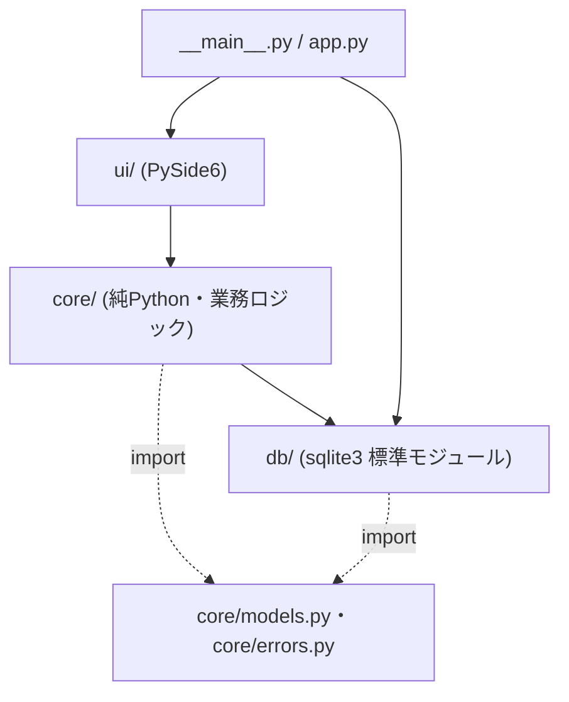
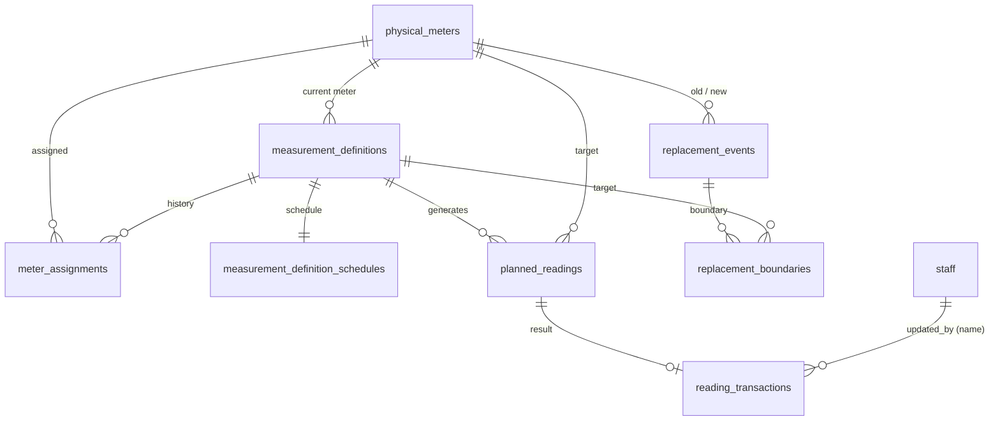

# 検針管理アプリ 開発計画書(基本設計)

- 作成日: 2026-10-20
- ステータス: 基本設計ドラフト(アーキテクチャ再編版)
- 参考文書:
  - [オフライン対応・Wi-Fi同期型_検針システム企画書_v4.md](../../migration_package/docs/plan/オフライン対応・Wi-Fi同期型_検針システム企画書_v4.md)(旧サーバー・Android 構成の企画記録。変更しない)
  - [ローカル在庫管理アプリ開発計画書.md](../ローカル在庫管理アプリ開発計画書.md)(共通基盤・スマホ HTML 連携・配布構成の設計基準)
- 位置付け: 旧企画書の業務要件・計算ルール(三層分離・Decimal 文字列・ロールオーバー・メーター交換境界・予定枠ライフサイクル・後続再計算)をすべて引き継ぎつつ、保守性の高い「ローカル PySide6 デスクトップアプリ ＋ 自己完結型単一 HTML(Quick Share 送受信)」構成へ再設計した正本。旧企画書と本書の記載が異なる場合は本書を正とする
- 将来統合方針: 備品在庫管理アプリ(`inventory-manager-mini`)および業務日誌アプリと将来的に 1 つの「設備管理アプリ」へ統合できるよう、技術スタック・層構成・DB 接続規約(`sqlite3` 標準モジュール)・バックアップ基盤・スマホ HTML エンベロープ規格を共通化する

---

## 1. 概要・スコープ

### 1.1 目的

施設内の電気・ガス・水道・ボイラー等のメーター検針業務をデジタル化し、ヒューマンエラーの削減と「料金試算・日常運用の根拠となる精緻なデータ集計」を自動化する。
ローカル PC サーバー(FastAPI/uvicorn/mDNS)やネイティブ Android アプリ(Kotlin/Jetpack Compose)の保守管理コストを排し、PC 上の管理・集計はローカルで完結する PySide6 デスクトップアプリとして実現する。現場のスマホ検針は、PC で出力した自己完結型の単一 HTML ファイルを Quick Share 等でスマホへ渡して Chrome で入力し、結果テキストまたは JSON ファイルを PC へ戻す方式で実現する。

### 1.2 MVP スコープ

| 区分 | 対象 |
| --- | --- |
| 対象 | 物理メーター管理、測定定義(`measurement_definitions`)・スケジュール管理、担当者(`staff`)マスタ管理、検針予定枠(`planned_readings`)の自動生成(backfill 含む)・締め処理(`auto_closed`)、スマホ検針(単一 HTML シート出力・Quick Share 送受信・差分プレビュー・一括確定)、PC 上での直接検針入力・訂正、臨時検針枠(`ad_hoc`)作成、メーター交換登録と交換境界差分計算、後続実測値の連鎖再計算、日次・月次使用量集計・グラフ表示(QtCharts)、CSV エクスポート、手動バックアップ・復元、多重起動防止、Windows インストーラー |
| 対象外 | ローカル HTTP サーバー(FastAPI / uvicorn)、mDNS 探索(zeroconf)、ネイティブ Android アプリ、Bearer トークン認証・QR コードペアリング、`active_device_id` による端末ロック、複数 PC からの同時 DB 編集 |

### 1.3 用語

| 用語 | 定義 |
| --- | --- |
| ロケーション(`location_id`) | 論理的な設置場所(例: 引込電力量計、ホテル厨房動力盤)。物理メーター交換時も変わらない集計の不変キー |
| 物理メーター(`meter_id`) | 実際の計器デバイス。故障や検定満了により交換される対象 |
| 測定定義(`measurement_definition_id`) | 「どの場所の・どの項目を・どの単位・倍率・計算方式・頻度で読むか」を表す論理的な測定対象。予定枠生成と差分計算の単位 |
| 検針目的(`purpose`) | 測定定義の用途区分(`operational`: 日常運用、`billing`: 費用按分根拠、`audit`: 監査・検証用)。同一メーターの二重計上を防ぐ集計フィルタに使用 |
| 検針予定枠(`planned_reading`) | 測定定義と業務日付(`business_date`)・検針枠(`reading_session`)から事前生成される 1 回分の検針タスク |
| 予定枠状態(`task_state`) | 予定枠のライフサイクル(`open`: 未消化、`completed`: 検針完了、`auto_closed`: 締め時刻経過による自動クローズ、`superseded`: メーター交換等による差し替え済み) |
| 検針結果状態(`result_status`) | 予定枠に対する現場の結果(`measured`: 実測、`skipped`: 見送り、`unreachable`: 検針不能、`meter_fault`: 計器不良、`replaced`: 交換済) |
| 使用量差分(`usage_delta`) | 前回実測値(`last_reading`)と今回実測値(`raw_reading`)の差に倍率(`multiplier`)を乗じた値。ロールオーバー補正を含む |
| 交換境界(`replacement_boundary`) | メーター交換時に旧メーターの最終使用量(`old_meter_usage_delta`)と新メーターの初期基準値(`new_initial_reading`)を保持するレコード |
| スマホ検針シート | 対象期間の予定枠とマスタ情報を内包した自己完結型単一 HTML ファイル |
| 担当者(`staff`) | PC 上での操作者および検針結果の確定・入力担当者 |

### 1.4 前提・制約

| 項目 | 内容 |
| --- | --- |
| 利用形態 | ローカルスタンドアロン。単一 PC・単一プロセスで運用し、スマホへは単一 HTML ファイルを Quick Share 等で受け渡す |
| 技術スタック | Python 3.13 / SQLite(`sqlite3` 標準モジュール) / PySide6 |
| 小数計算 | 浮動小数点(`float`)は使用禁止。Python 内は `decimal.Decimal`、SQLite 保存および JSON 入出力は plain decimal 文字列(`TEXT`)とする |
| ネットワーク | 完全オフラインで全機能が動作すること(外部通信は一切行わない) |
| 対象 OS | PC: Windows 10 以上(Inno Setup でインストーラーを作成)、Linux(Python 環境を構築して実行) / スマホ: Android(Chrome) |
| 画面解像度 | PC: 1366×768 以上(文字サイズ 150% でも画面内に収まること) |
| 時刻と業務日付 | DB の時刻列(`recorded_at`、`scheduled_at`、`replaced_at` 等)は UTC で保存し、予定生成・締め判定・集計はローカルタイムゾーン基準の `business_date`(`YYYY-MM-DD`)と `reading_session`(`HH:MM`)で行う |

---

## 2. 開発環境・ツールチェーン

在庫管理アプリ([ローカル在庫管理アプリ開発計画書.md](ローカル在庫管理アプリ開発計画書.md) 2 章)と完全に同一のツールチェーンを採用する。

| 項目 | 選択 | 理由 |
| --- | --- | --- |
| Python | 3.13(`requires-python = ">=3.13"`) | 在庫管理アプリと統一 |
| パッケージ管理 | uv(`pyproject.toml` + `uv.lock`) | 高速・再現性担保 |
| ビルドバックエンド | hatchling(`src/` レイアウト) | 在庫管理アプリと統一 |
| 主要依存 | PySide6、platformdirs、pydantic(データ契約・JSON 検証用) | HTTP/Web 系依存(FastAPI, uvicorn, zeroconf, argon2, segno, SQLAlchemy, Alembic)を廃止し軽量化 |
| 開発依存 | pytest、pytest-qt、pytest-cov、Playwright(単一 HTML 検針シートの自動テスト)、ruff、pyright、pyinstaller、tzdata | 在庫管理アプリと同一の品質ゲート |
| DB アクセス | `sqlite3` 標準モジュール | 単一ユーザーで ORM は不要。`sqlite3.Connection.backup()` と `PRAGMA user_version` による堅牢なバックアップ・復元・マイグレーションを在庫管理アプリと共通化できる |

---

## 3. アーキテクチャと将来統合設計

### 3.1 層構成と依存方向



- 業務処理の呼び出し方向は `ui → core の Service → db` の一方向とする
- `core/` と `db/` は PySide6 を import しない(静的検査・依存ルールのテストで担保)
- `core/` の既存サービス群(`WorkPackageDownloadService`、`MeterReadingSyncService`、`ReadingWriteOrchestrationService`、`UsageDeltaCalculationService`、`MeterMasterService` 等)は `core/meter_reading_sync_repositories.py` の `Protocol` 群を介して `db/repositories.py` を呼び出す
- Service はトランザクション境界を持つ。1 つの業務操作 = `with transaction(conn):`(`BEGIN IMMEDIATE`)による 1 トランザクション

### 3.2 将来の「設備管理アプリ」統合を見据えたモジュール構成

将来的に「備品在庫管理(`inventory`)」「検針管理(`meter_reading`)」「業務日誌(`work_log`)」を 1 つの PySide6 アプリケーションへ統合する際、そのままサブパッケージとして合流できる構成とする。

```text
meter-reading-app/
├─ pyproject.toml / uv.lock
├─ docs/
│  └─ plan/
│     └─ ローカル検針管理アプリ開発計画書.md  # 本書
├─ src/meter_reading_mini/
│  ├─ __main__.py
│  ├─ app.py                                # 起動シーケンス・自動クローズ・当日予定生成
│  ├─ config.py                             # パス解決(platformdirs)
│  ├─ core/
│  │  ├─ contract_models.py                 # 語彙 StrEnum・Decimal 文字列シリアライズ・DTO
│  │  ├─ errors.py                          # DomainError 基底と業務例外
│  │  ├─ meter_reading_sync_repositories.py # Repository Protocol と入出力レコード定義
│  │  ├─ usage_delta_calculation.py         # 差分計算・ロールオーバー補正(純関数)
│  │  ├─ reading_write_orchestration.py     # 保存前履歴照合・交換境界適用・後続再計算
│  │  ├─ meter_reading_sync.py              # 検針結果・交換イベントの一括 Upsert
│  │  ├─ work_package_download.py           # 予定枠 backfill 生成・auto_closed・グループ化
│  │  ├─ meter_master_service.py            # 物理メーター・測定定義 CRUD
│  │  ├─ schedule_settings.py               # スケジュール設定・締め時刻設定サービス
│  │  ├─ timezone_settings.py               # タイムゾーン・業務日付算出
│  │  ├─ reading_signature.py               # 監査用 SHA-256 署名計算
│  │  ├─ mobile_reading.py                  # 単一 HTML 検針シート生成・MR1 結果テキスト/JSON 解析
│  │  └─ reports.py                         # 期間集計・CSV エクスポート
│  ├─ db/
│  │  ├─ connection.py                      # sqlite3 接続(autocommit=True)・PRAGMA・transaction()
│  │  ├─ schema.sql                         # 最新 DDL
│  │  ├─ migrations.py                      # SCHEMA_VERSION・版別スキーマ検査・移行
│  │  ├─ repositories.py                    # 標準 sqlite3 による Repository Protocol 実装
│  │  ├─ bootstrap_seeds.py                 # 初期マスタ・設定 seed データ
│  │  ├─ integrity.py                       # 復元・移行時の業務整合性検査
│  │  └─ backup.py                          # バックアップ・復元
│  └─ ui/
│     ├─ single_instance.py                 # 多重起動防止(QLockFile)
│     ├─ display_settings.py                # フォント・文字サイズ設定(ui_settings.json)
│     ├─ main_window.py                     # 予定枠・検針結果一覧・フィルタ・操作導線
│     ├─ dialogs/                           # スマホ検針・PC直接入力・臨時検針・メーター交換・マスタ・設定
│     └─ widgets/                           # 集計ダッシュボード(QtCharts)
└─ tests/
```

---

## 4. DB 基本設計(標準 `sqlite3`)

### 4.1 ER 図



### 4.2 スキーマ(`db/schema.sql`)

在庫管理アプリのテーブル群(`items`, `stock_movements`, `stock_allocations`, `categories`, `locations`, `clients`, `purchasers`, `settings`)と同一 SQLite ファイルに同居しても名前が衝突しないよう、検針設定テーブルは `meter_app_settings` とし、担当者テーブル `staff` は在庫管理アプリと同一スキーマとする。

```sql
CREATE TABLE staff (
  id INTEGER PRIMARY KEY,
  name TEXT NOT NULL UNIQUE,
  is_active INTEGER NOT NULL DEFAULT 1 CHECK (is_active IN (0, 1))
);

CREATE TABLE physical_meters (
  meter_id TEXT PRIMARY KEY,
  location_id TEXT NOT NULL,
  location_name TEXT NOT NULL,
  meter_name TEXT NOT NULL,
  category TEXT NOT NULL CHECK (category IN ('electricity','gas','water','boiler','others')),
  meter_serial TEXT,
  is_active INTEGER NOT NULL DEFAULT 1 CHECK (is_active IN (0, 1))
);
CREATE INDEX idx_physical_meters_location ON physical_meters(location_id);

CREATE TABLE measurement_definitions (
  measurement_definition_id TEXT PRIMARY KEY,
  location_id TEXT NOT NULL,
  meter_id TEXT REFERENCES physical_meters(meter_id),
  display_name TEXT NOT NULL,
  category TEXT NOT NULL CHECK (category IN ('electricity','gas','water','boiler','others')),
  unit TEXT NOT NULL,
  value_schema TEXT NOT NULL CHECK (value_schema IN ('decimal_string','power_factor_percent_phase')),
  multiplier TEXT NOT NULL,
  decimal_places INTEGER CHECK (decimal_places IS NULL OR (typeof(decimal_places) = 'integer' AND decimal_places BETWEEN 0 AND 10)),
  warning_threshold TEXT,
  rollover_value TEXT,
  calculation_method TEXT NOT NULL CHECK (calculation_method IN ('delta','raw_only')),
  reading_cycle TEXT NOT NULL CHECK (
    reading_cycle IN ('daily_1x','daily_2x','daily_3x','weekly','monthly','every_two_months')
  ),
  purpose TEXT NOT NULL DEFAULT 'operational' CHECK (purpose IN ('operational','billing','audit')),
  is_active INTEGER NOT NULL DEFAULT 1 CHECK (is_active IN (0, 1))
);
CREATE INDEX idx_measurement_defs_location ON measurement_definitions(location_id);

CREATE TABLE measurement_definition_schedules (
  measurement_definition_id TEXT PRIMARY KEY
    REFERENCES measurement_definitions(measurement_definition_id),
  schedule_json TEXT NOT NULL,
  updated_at TEXT NOT NULL
);

CREATE TABLE meter_assignments (
  measurement_definition_id TEXT NOT NULL
    REFERENCES measurement_definitions(measurement_definition_id),
  meter_id TEXT NOT NULL REFERENCES physical_meters(meter_id),
  effective_from TEXT NOT NULL,
  effective_to TEXT,
  PRIMARY KEY (measurement_definition_id, meter_id, effective_from)
);

CREATE TABLE planned_readings (
  planned_reading_id TEXT PRIMARY KEY,
  measurement_definition_id TEXT NOT NULL
    REFERENCES measurement_definitions(measurement_definition_id),
  meter_id TEXT NOT NULL REFERENCES physical_meters(meter_id),
  location_id TEXT NOT NULL,
  business_date TEXT NOT NULL,
  release_date TEXT NOT NULL,
  reading_session TEXT NOT NULL,
  scheduled_at TEXT NOT NULL,
  task_state TEXT NOT NULL DEFAULT 'open' CHECK (
    task_state IN ('open','completed','auto_closed','superseded')
  ),
  closed_at TEXT,
  close_reason TEXT
);
CREATE INDEX idx_planned_readings_def_sched
  ON planned_readings(measurement_definition_id, scheduled_at, planned_reading_id);
CREATE INDEX idx_planned_readings_business_date ON planned_readings(business_date);
CREATE INDEX idx_planned_readings_release_date ON planned_readings(release_date);

CREATE TABLE reading_transactions (
  planned_reading_id TEXT PRIMARY KEY
    REFERENCES planned_readings(planned_reading_id),
  result_status TEXT NOT NULL CHECK (
    result_status IN ('measured','skipped','unreachable','meter_fault','replaced')
  ),
  recorded_at TEXT NOT NULL,
  client_updated_at TEXT NOT NULL,
  raw_reading TEXT,
  last_reading TEXT,
  usage_delta TEXT,
  structured_payload_json TEXT,
  device_id TEXT NOT NULL DEFAULT '',
  updated_by TEXT NOT NULL,
  signature TEXT NOT NULL,
  note TEXT,
  result_source TEXT,
  arrival_sequence INTEGER NOT NULL DEFAULT 1
);

CREATE TABLE replacement_events (
  replacement_event_id TEXT PRIMARY KEY,
  location_id TEXT NOT NULL,
  old_meter_id TEXT NOT NULL REFERENCES physical_meters(meter_id),
  new_meter_id TEXT NOT NULL REFERENCES physical_meters(meter_id),
  replaced_at TEXT NOT NULL,
  old_final_reading TEXT,
  new_initial_reading TEXT,
  client_updated_at TEXT NOT NULL,
  updated_by TEXT NOT NULL,
  note TEXT,
  arrival_sequence INTEGER NOT NULL DEFAULT 1
);
CREATE INDEX idx_replacement_events_location ON replacement_events(location_id);

CREATE TABLE replacement_boundaries (
  replacement_event_id TEXT NOT NULL REFERENCES replacement_events(replacement_event_id),
  measurement_definition_id TEXT NOT NULL
    REFERENCES measurement_definitions(measurement_definition_id),
  location_id TEXT NOT NULL,
  business_date TEXT NOT NULL,
  old_meter_id TEXT NOT NULL REFERENCES physical_meters(meter_id),
  new_meter_id TEXT NOT NULL REFERENCES physical_meters(meter_id),
  replaced_at TEXT NOT NULL,
  previous_measured_reading TEXT,
  previous_measured_planned_reading_id TEXT,
  old_final_reading TEXT,
  old_meter_usage_delta TEXT,
  new_initial_reading TEXT,
  created_at TEXT NOT NULL,
  updated_at TEXT NOT NULL,
  PRIMARY KEY (replacement_event_id, measurement_definition_id)
);

CREATE TABLE meter_app_settings (
  setting_key TEXT PRIMARY KEY,
  setting_value TEXT NOT NULL,
  updated_at TEXT NOT NULL
);
```

---

## 5. 業務ルール

### 5.1 コア計算・データ整合性ルール(既存仕様の継承)

1. **三層分離**: `location_id`(集計場所)、`meter_id`(物理計器)、`measurement_definition_id`(論理測定対象)を分離する。同一ロケーションに複数の測定対象(積算電力量、最大需要電力、力率等)を持てる。
2. **浮動小数点の排除**: すべての測定値・倍率・閾値・ロールオーバー値・使用量差分は `decimal.Decimal` で計算し、DB・JSON では plain decimal 文字列として保持する。
3. **ロールオーバー補正と差分計算(`UsageDeltaCalculationService`)**:
   - `calculation_method = 'raw_only'` の場合は `usage_delta = None` とする。
   - `calculation_method = 'delta'` かつ `value_schema = 'decimal_string'` の場合は、直前の実測値(`last_reading`)との差分に `multiplier` を乗じて `usage_delta` を算出する。
   - `raw_reading < last_reading` のとき、`rollover_value` が設定されていれば `(rollover_value - last_reading + raw_reading) * multiplier` で補正し、未設定であれば負の差分を異常値として拒否する。
4. **予定枠の自動生成と自動クローズ(`WorkPackageDownloadService`)**:
   - PC アプリ起動時および検針シート出力時に、対象業務日までの未生成予定枠を `measurement_definition_schedules` と `meter_app_settings` に基づき backfill 生成する。
   - 締め時刻(`cutoff_time`、初期値 `07:00`)を過ぎた時点で、前日以前の未消化(`open`)予定枠を `auto_closed` に遷移させる。
   - `auto_closed` となった予定枠に対しても、後からスマホ検針結果または PC 直接入力が届いた場合は現場入力を優先して `completed` に更新し、`usage_delta` を再計算する。
5. **後続実測値の連鎖再計算(`ReadingWriteOrchestrationService`)**:
   - 過去枠の追加入力や訂正により実測値が確定・変更された場合、`scheduled_at, planned_reading_id` 順で後続する同一測定定義の実測レコードを探索し、`last_reading` と `usage_delta` を連鎖的に再計算して更新する。
6. **メーター交換(`ReplacementEvent` / `ReplacementBoundary`)**:
   - メーター交換時は、旧メーターの最終読値(`old_final_reading`)から交換境界の使用量(`old_meter_usage_delta`)を確定し、新メーター初回実測時は `new_initial_reading` を `last_reading` として使用する(`new_initial_reading` が未指定の場合のみ初回 `usage_delta = 0`)。
   - 未消化(`open` / `auto_closed`)の旧メーター予定枠は `superseded` に変更し、新メーター向けの予定枠を生成する。

### 5.2 スマホ検針(単一 HTML ＋ Quick Share 方式)

在庫管理アプリのスマホ棚卸([ローカル在庫管理アプリ開発計画書.md](ローカル在庫管理アプリ開発計画書.md) 5.2.3)のアーキテクチャを踏襲しつつ、検針業務向けに以下のルールとする。

#### 5.2.1 検針シート HTML の出力(PC → スマホ)

- **配布単位と出力対象フィルタ**:
  - 既定は「対象業務日(既定は当日)の 1 日分すべて(日次全枠 ＋ 該当日の週次・月次・隔月・臨時枠)」を 1 つの単一 HTML ファイルとして出力する。
  - ただし、「時間帯ごとに別担当者が別端末で回る」「午前分を PC に確定反映した後に午後分だけ最新状態で出力したい」といった運用にも対応できるよう、出力時に特定の検針枠(`reading_session`: `08:00`、`14:00`、`22:00` 等)または周期区分に絞って出力するオプションを提供する。
  - ファイル名既定は、全枠出力時が `meter_reading_YYYYMMDD_HHMMSS.html`、特定枠指定時が `meter_reading_YYYYMMDD_<session>_HHMMSS.html`(例: `meter_reading_20261020_0800_075012.html`)とする。
- HTML には一意な `sheet_id`(32 文字の小文字 16 進数)、出力日時、出力対象条件、`WorkPackageResponse` 相当の JSON データ(物理メーター、測定定義、`daily_tasks` / `weekly_tasks` / `monthly_tasks` / `every_two_months_tasks` / `ad_hoc_tasks`)、CSS、JavaScript をすべて内包し、外部通信を一切行わない。
- Android の簡易ビューア(JavaScript 無効環境)で開かれた場合に備え、冒頭に「Chrome で開いてください」の案内を表示する。

#### 5.2.2 スマホ Chrome での入力と途中保存

- **3 段構えのナビゲーション・絞り込み UI(片手操作最適化)**:
  1. **最上部: 検針時間(`reading_session`)・周期の横スクロール・ピルタブ(自動フォーカス付き)**
     - `[すべて] [08:00 (3/12)] [14:00 (0/8)] [22:00 (0/12)] [週次・月次・隔月 (1/5)] [臨時 (0/1)]` のように、各枠の消化件数バッジ付きピルタブを上部に固定表示する。
     - **初期自動選択**: HTML を開いた際、未消化タスクが残っている最も早い検針枠(または現在時刻に最も近い検針枠)のピルタブを自動選択して表示する。これにより、1 日 1 ファイルでありながら「今の時間帯の検針専用シートを開いた」のと同等のシンプルな初期表示を実現する。
  2. **中段: 設置場所(`location_id`)別グルーピングとクイック絞り込みバー**
     - 現場では場所(受変電室、ボイラー室、厨房等)を移動しながら複数メーターをまとめて読むため、リストは `location_id` ごとのセクション見出し(Sticky Header / アコーディオン開閉可)でグループ化して表示する(`location_id` 未設定は末尾の「場所未設定」セクションにまとめる)。
     - セクション内の並び順は `category` 固定順(`electricity` → `gas` → `water` → その他)＋ `display_name` 昇順とする。
     - 画面上部に「設置場所ドロップダウン(特定の場所へ即座に絞り込み/ジャンプ)」と「未入力のみ表示トグル」を配置する。場所内の全項目が入力済みになるとセクション見出しに完了バッジを表示し、ワンタップまたは自動で折りたためるようにする。
  3. **カード内: 連続入力導線**
     - 同一ロケーション内に複数の測定項目がある場合にスクロールの手間を省くため、数値・状態を入力して確定した際に同じ場所の次の未入力項目へフォーカス(またはスクロール位置)を進める「次へ」導線を提供する。
- **入力とローカル即時検証(同日先行枠からの前回値動的引き継ぎを含む)**:
  - 各予定枠に対し、状態(`measured` / `skipped` / `unreachable` / `meter_fault`)を選択できる。
  - `decimal_string` の場合は数値入力欄を表示し、前回値(`last_reading`)・倍率(`multiplier`)・小数桁数(`decimal_places`)・ロールオーバー値(`rollover_value`)から参考使用量を即時計算して画面表示する。
  - **同一測定定義の同日複数回検針における前回値の動的引き継ぎ**: 1 日 1 ファイル内で同一 `measurement_definition_id` の複数枠(例: `08:00` と `14:00`)が含まれる場合、`08:00` 枠で実測値(`measured`)を入力すると、後続する `14:00` 枠の表示上の前回値(`last_reading`)および参考使用量計算にその入力値をリアルタイムに反映する(未入力時はシート出力時点の DB 前回値を使用する)。
  - 算出した参考使用量が `warning_threshold` を超える場合、または前回値を下回る場合は警告バナーを表示する(現場での実数記録自体は妨げない)。
  - `power_factor_percent_phase` の場合は `%`(0〜100)と位相(`lag` / `lead` / `unity`、`100%` のときは `unity` 自動固定)を入力する。
- **自動保存(IndexedDB)と下書き形式**:
  - `localStorage` は使わず、IndexedDB(`mrm_meter_reading`、DB 版数 1、`drafts` ストア)へ `sheet_id` 単位で操作状態を自動保存・復元する。結果状態(`result_status`)・測定値(`raw_reading`)・力率(`%`・位相)・備考(`note`)・確認・確認解除・リセットの変更を保存対象とする。
  - 保存状態を「読込中」「保存中」「保存済み」「保存失敗」で示し、「保存済み」は最新の変更に対応する書込トランザクションの完了を確認した状態を表す。保存完了後の強制終了や電源断まで保証するものではない。
  - 保存データと途中経過 JSON(途中バックアップ)は、種別・版数・`sheet_id`・対象業務日・出力日時・出力対象条件・対象予定枠(`planned_reading_id`・測定定義・初期前回値等)の一致を検証する下書き形式(v1)を使う。空欄・不正な数値・範囲外の力率・長すぎる備考等の入力途中状態も保持・復元するが、業務条件を満たさない予定枠は確認済みにしない(測定値・状態・備考の変更時は確認を解除する)。既存保存データを確認できない場合に初期状態で自動上書きせず、別タブとの保存競合時も自動マージ・上書きを行わない。
- **途中経過 JSON(途中バックアップ)の保存・読込(フォールバック)**:
  - IndexedDB の保存領域が利用できない場合も、入力内容を維持して警告を表示し、再試行と途中経過 JSON(途中バックアップ)を利用できる。
  - 途中経過 JSON は利用者の明示操作で保存し、未確認・入力途中のエラーも含む。読込時は同じシートのデータであることを検証し、確認後に現在の入力全体を置き換える(自動マージはしない)。読込後は同日先行枠からの前回値動的引き継ぎ・参考使用量・警告表示も再計算して反映する。
  - ファイルとしてダウンロードできない場合は JSON の表示・手動コピーと貼付読込を使う。途中経過 JSON は平文の JSON ファイルであり、利用者が安全に保管し、不要になったら手動で削除する。結果を出力・確定しても自動削除しない。
- **Android 実機での自動復元保証範囲**:
  - 在庫管理アプリの最終実機確認(2026-10-21、moto g66j 5G / Android 16、Chrome 155.0.8059.79 通常モード、Quick Share → Files → Chrome の `content://com.google.android.apps.nbu.files.provider` 経路)と同一の運用前提とする。同じ端末・Chrome・HTML・起動経路では、Chrome 終了後および端末再起動後に自動復元でき、Quick Share からの再取得後も復元できる。HTML を移動した場合は自動復元できず、途中経過 JSON(途中バックアップ)から回復する。
  - 自動復元を保証する範囲は実機で確認したこの条件に限り、Gmail 経由・別ブラウザ・プライベートモード・ファイル移動後の IndexedDB 継続利用は保証しない。保存領域の消去・退避、ブラウザによる消去、容量不足、ブラウザ更新、保存トランザクション完了前の強制終了、最後の途中バックアップ以降の変更からの回復も保証しない。アプリ更新は、既に作成・配布した HTML の JavaScript や途中データを更新・移行しない。
- **結果の出力(部分入力の許容)**:
  - 棚卸とは異なり、1 日複数回の検針(08:00 枠のみ先に提出など)や複数日分の分割入力に対応するため、**確認済みの予定枠が 1 件以上あり、かつ確認済み枠の入力がすべて正常であれば、未確認の予定枠が残っていても結果出力を許可する**(未確認の予定枠は出力ペイロードに含めない)。
  - 出力経路は以下の 2 通りを提供する:
    1. **結果テキスト**: UTF-8 JSON を標準 Base64 化し、Base64 文字列の CRC-32(小文字 16 進 8 桁)を付与した `MR1:<Base64>.<CRC32>:END` 形式(在庫管理アプリの `IMM1:` とプレフィックスで識別可能にする)。メール本文の前後文字、折り返し、行頭の引用符 `>` を含む入力を許容するが、異なる結果ブロックが複数ある場合は自動選択せず拒否し、同一内容の重複ブロックだけを 1 件として扱う。
    2. **JSON ファイル**: 同一の JSON ペイロードをファイルとして保存し、PC のファイル選択から読み込む。
  - コピー失敗時やファイル保存の例外時には結果テキストを全選択状態で表示して手動コピーを案内する。保存成功を検出できないダウンロード経路では完了を断定しない。確認済み枠が 1 件以上あれば、コピー・保存の成否にかかわらず利用者が結果テキストを表示できる。

#### 5.2.3 PC 側でのプレビューと一括確定(スマホ → PC)

- PC の `MobileReadingDialog` で結果テキストの貼り付け、または JSON ファイルの選択を行う。
- `core/mobile_reading.py` が `MR1:` エンベロープの CRC-32 検証、JSON パース、`MeterReadingSubmission` のバリデーションを行う。途中経過 JSON(下書き形式)が入力された場合は結果として拒否し、`MR1:` テキストおよび結果 JSON のパーサ互換性を維持する。
- 入力の編集、ファイル/クリップボードの再読込開始、解析・プレビュー失敗時には旧プレビューと確定用データを破棄し、最後に正常プレビューした入力そのものだけを再検証後に確定可能とする。
- DB へ書き込む前に、対象の各予定枠について以下を計算し、プレビュー表に表示する:
  - 設置場所・測定項目名・業務日・検針枠(`reading_session`)
  - 現在の DB 状態(新規入力か、既存 `completed` の上書きか、`auto_closed` からの復活か)
  - 前回値(`last_reading`)、今回入力値(`raw_reading` / `structured_payload`)、算出される `usage_delta`
  - 警告閾値超過・ロールオーバー発生・負の差分エラーの有無
- 利用者が確定担当者(`staff`)を選択して「一括確定」を押すと、単一トランザクションで `MeterReadingSyncService` を実行し、結果を永続化する。
  - `device_id` には `sheet_id`、`updated_by` には選択した確定担当者名、`result_source` には `'mobile_html'` を記録し、`reading_signature.py` で監査用署名を生成する。

---

## 6. 画面設計(PySide6)

### 6.1 画面一覧

| 画面 | 主な構成要素 | 入力・活性制御 |
| --- | --- | --- |
| `MainWindow` | 対象業務日選択(カレンダ/前後日ボタン/今日ボタン)、周期タブ(すべて/日次/週次/月次/隔月/臨時)、状態フィルタ(`open`/`completed`/`auto_closed`/`superseded`)、カテゴリ・ロケーション検索、予定枠・結果一覧(`QTableView` + `QAbstractTableModel`)、消化状況・警告件数ステータスバー | 行選択で「PC直接入力・訂正」を活性化。未消化(`open`)枠は強調表示、警告閾値超過行は黄色着色、`auto_closed` 行はグレー表示。ツールバーから「スマホ検針シート出力・結果取込」「PC直接入力」「臨時検針作成」「メーター交換」「マスタ管理」「集計ダッシュボード」へ遷移 |
| `MobileReadingDialog` | 【タブ1: シート出力】基準業務日、出力対象範囲フィルタ(既定:「1日分すべて」、または特定の検針枠 `reading_session` / 周期枠の選択)、出力担当者選択、「HTML シート出力」ボタン / 【タブ2: 結果取込・確定】クリップボード貼付ボタン、テキスト欄、JSON ファイル読込ボタン、差分プレビュー表(前回値・今回値・使用量・警告・上書き区分)、確定担当者選択、「一括確定」ボタン | プレビュー成功後かつ有効な確定担当者選択時のみ「一括確定」を活性化。入力テキスト変更時や再読込失敗時は旧プレビューを破棄して確定ボタンを不活性化(在庫管理アプリと同一の安全規約) |
| `DirectReadingDialog` | 選択した予定枠の情報表示、結果状態(`measured`/`skipped`/`unreachable`/`meter_fault`)、測定値または力率入力、記録日時、入力担当者(`staff`)、備考、使用量プレビュー | PC 上で紙の控えた検針値を直接入力、または既存結果の訂正を行う。確定時はスマホ取り込みと同じ `ReadingWriteOrchestrationService` を経由して保存・後続再計算する |
| `AdHocReadingDialog` | 測定定義選択、業務日付、検針枠(`reading_session`)、作成担当者 | 臨時検針枠(`ad_hoc`)を追加する |
| `MeterReplacementDialog` | 対象ロケーション・旧メーター選択、新メーター選択(または新規登録)、交換日時、旧メーター最終読値(`old_final_reading`)、新メーター初期読値(`new_initial_reading`)、担当者、備考 | 確定時に `replacement_events`・`replacement_boundaries` の記録、`meter_assignments` の切り替え、未消化予定枠の `superseded` 化と新予定枠生成を単一トランザクションで実行 |
| `MasterDialog` | タブ1: 物理メーター(`physical_meters`) / タブ2: 測定定義・スケジュール(`measurement_definitions`・`measurement_definition_schedules`) / タブ3: 担当者(`staff`) | 使用中マスタは論理削除(`is_active = 0`)で保護。測定定義ごとに個別スケジュールまたは全体既定スケジュールを設定可能 |
| `DashboardWindow` | 期間選択(月次/日次/年次)、検針目的(`operational`/`billing`/`audit`)フィルタ、カテゴリ・ロケーション・測定定義フィルタ、推移グラフ(`QtCharts`)、集計内訳表、CSV / PNG 出力 | 二重計上防止のため、検針目的(`purpose`)の初期選択は `operational` とし、`billing`(請求・按分用)等へ切り替え可能とする |
| `SettingsDialog` | 締め時刻(`cutoff_time`)、周期別の既定スケジュール・配信オフセット、UI 表示設定(フォント・文字サイズ) | フォント・文字サイズは `ui_settings.json` に保存し即時反映 |

---

## 7. バックアップ・復元と非機能設計

在庫管理アプリ([ローカル在庫管理アプリ開発計画書.md](ローカル在庫管理アプリ開発計画書.md) 7 章)と完全に共通の設計とする。

- **多重起動防止**: データディレクトリの `meter_reading.lock`(`QLockFile`)で二重起動を防止する。
- **バックアップ**: `sqlite3.Connection.backup()` により `meter_reading_YYYYMMDD_HHMMSS.db` を出力する。
- **復元と整合性検査**:
  1. 復元元を `mode=ro` で開き、`PRAGMA user_version`、版別スキーマ、`integrity_check`、`foreign_key_check` を検査する。
  2. 一時 DB へコピーし、旧版であれば最新版へマイグレーションする。
  3. 業務整合性検査(すべての Decimal 文字列カラムが有限の plain decimal として解釈可能か、`reading_transactions` の状態と値の整合性、交換境界の整合性)を実行する。
  4. 合格後、現行 DB を `backups/pre-restore_日時.db` に自動保全した上で上書きし、アプリを再起動する。

---

## 8. 移行・開発フェーズ計画

| フェーズ | 内容 | 主な成果物 | 完了条件 |
| --- | --- | --- | --- |
| Phase 0 | 新リポジトリ骨格・共通基盤構築・CI 整備・`main` 保護 | `pyproject.toml`, `config.py`, `db/connection.py`, `ui/single_instance.py`, `ui/display_settings.py`, `.github/workflows/ci.yml`, GitHub 側の `main` 保護設定 | 多重起動防止・ログ・UI 設定が動作し、ローカルおよび Windows / Ubuntu の CI で ruff / pyright / pytest が通過。PR 必須・両 OS のチェック必須を設定し、実際の PR で CI 未成功時のブロックと成功後のマージを確認。完了記録 PR の merge 時に結果を記録し、作業計画書を凍結移動 |
| Phase 1 | 標準 `sqlite3` スキーマ実装と既存コア業務ロジックの統合 | `db/schema.sql`, `db/migrations.py`, `db/repositories.py`, `db/bootstrap_seeds.py`, `core/*`(既存の `migration_package` 資産) | 既存の単体テスト一式(差分計算・オーケストレーション・同期・予定生成・スケジュール・マスタ)と標準 `sqlite3` リポジトリ統合テストが全件成功。Phase 0 で設定した検査対象外をすべて解除し、全テスト・全品質ゲートが成功 |
| Phase 2 | 単一 HTML 検針シート生成・結果パーサ(`MR1:`)・Playwright 自動テスト | `core/mobile_reading.py`, `tests/test_mobile_reading.py`, `tests/test_mobile_reading_browser.py` | HTML 生成(全枠/特定枠指定) → Chromium(`file:` URL)での検針枠ピルタブ切替・場所別グルーピング/絞り込み・同日先行枠からの前回値引き継ぎ・数値/力率入力・警告表示・IndexedDB 自動保存/再開/途中入力保持/保存障害/非同期競合・途中経過 JSON(途中バックアップ)往復/別シート拒否/IndexedDB なし退避 → `MR1:` テキスト & 結果 JSON 出力(下書き形式の結果拒否を含む) → Python パーサ → `MeterReadingSyncService` 保存の往復テスト成功 |
| Phase 3 | MainWindow・マスタ管理・PC 直接検針・臨時検針・メーター交換 UI | `ui/main_window.py`, `MasterDialog`, `DirectReadingDialog`, `AdHocReadingDialog`, `MeterReplacementDialog` | UI からマスタ登録、予定枠生成・自動クローズ、PC 直接入力、メーター交換が一通り操作可能 |
| Phase 4 | スマホ検針ダイアログ(HTML 出力・差分プレビュー・一括確定) | `ui/dialogs/mobile_reading_dialog.py` | HTML 出力から結果テキスト貼付/JSON 読込、保存前の差分・警告プレビュー、一括確定までが UI で完結 |
| Phase 5 | 集計ダッシュボード・CSV 出力・バックアップ/復元・インストーラー | `ui/widgets/dashboard.py`, `core/reports.py`, `db/backup.py`, `db/integrity.py`, `packaging/*` | 目的別・ロケーション別集計とグラフ表示、CSV/PNG 出力、復元検査、PyInstaller + Inno Setup ビルド成功 |

- **Phase 0 の CI・`main` 保護の実装内容・完了確認**:
  - [x] ローカルと CI で共通の ruff / pyright / pytest の実行手順を整備し、Phase 0 の検査対象を明記する。未移植コード・既存テストの統合は Phase 1 の完了条件として残し、CI を通すための無断のスキップや検査無効化は行わない。
  - [x] リポジトリ直下の `.github/workflows/ci.yml` に GitHub Actions を用意し、`main` 向け PR と `main` への push で Windows / Ubuntu の品質チェックを実行する。チェック名は `test (windows-latest)`・`test (ubuntu-latest)` とする。
  - [x] CI を実際に実行し、両 OS のチェック成功と GitHub 上のチェック名を確認してから、`main` の必須チェックに登録する。ジョブ名を変更するときは必須チェック名も同時に更新する。
  - [x] GitHub 側の Ruleset またはブランチ保護ルールを `main` に対して有効化し、PR 経由のマージ・上記 2 チェックの成功を必須とする。force push・ブランチ削除を禁止し、通常運用で直接 push や未成功チェックのマージを許す bypass は設けない。この設定は workflow の追加とは別に行う。
  - [x] `feature/<フェーズ>-<内容>` ブランチから実際の PR を作成し、CI 未成功時はマージがブロックされ、両 OS のチェック成功後にマージできることを確認する。[失敗系 PR #2](https://github.com/sho-kawasaki-dd/meter-reading-app-mini/pull/2) と[成功系 PR #1](https://github.com/sho-kawasaki-dd/meter-reading-app-mini/pull/1) を確認済み。
  - [x] 完了締め PR で GitHub 検証結果を記録し、両 OS の必須チェック成功後に merge する。作業計画書を `docs/plan/implemented/` へ移し、README と本計画の完了状態を同期する。

- **Phase 0 の品質ゲート検査対象**:
  - ruff / pyright / pytest: `src/meter_reading_mini/config.py`, `app.py`, `core/errors.py`, `core/timeutil.py`, `core/logging_config.py`, `core/mobile_reading.py`, `db/connection.py`, `db/migrations.py`, `db/backup.py`, `ui/*`; `tests/conftest.py` と `test_backup.py`, `test_config.py`, `test_connection.py`, `test_csv_export.py`, `test_dialog_placement.py`, `test_display_settings.py`, `test_error_handling.py`, `test_errors.py`, `test_migrations.py`, `test_mobile_reading_envelope.py`, `test_single_instance.py`, `test_timeutil.py`。
  - coverage 90 %: 上記のうち `src/meter_reading_mini/` 配下にある Phase 0 モジュール(`config.py`, `app.py`, `core/errors.py`, `core/timeutil.py`, `core/logging_config.py`, `db/connection.py`, `db/migrations.py`, `db/backup.py`, `ui/*`)。テストファイルと `core/mobile_reading.py` は coverage 集計から除外する。
  - **Phase 1 で解除する検査対象外**: `src/meter_reading_mini/core/contract_models.py`, `meter_master_service.py`, `meter_reading_sync.py`, `meter_reading_sync_repositories.py`, `reading_signature.py`, `reading_write_orchestration.py`, `schedule_settings.py`, `timezone_settings.py`, `usage_delta_calculation.py`, `work_package_download.py`, `src/meter_reading_mini/db/reference_sqlalchemy/**`; 対応する `tests/test_api_models.py`, `test_measurement_definition_schedule_service.py`, `test_meter_master_service.py`, `test_meter_reading_sync_service.py`, `test_meter_reading_sync_service_batch_txn.py`, `test_reading_signature.py`, `test_reading_write_orchestration.py`, `test_timezone_settings.py`, `test_usage_delta_calculation.py`, `test_work_package_download_service.py`。
  - 対象外の理由は、旧プロジェクト由来の `api.*` / `application.*` / `core.*` import と `sqlalchemy` 依存が残り、標準 `sqlite3` への移植・統合を Phase 1 で行うため。対象外は `pyproject.toml` の ruff / pyright / pytest / coverage 設定に明示し、Phase 1 完了時に解除する。個別 skip の追加や閾値の引き下げは行わない。
  - Windows では `test_timeutil.py` の `time.tzset()` テスト1件を既存の OS 条件で skip し、Ubuntu では実行する。新規 skip は追加しない。

- **スマホ検針シートのブラウザテスト・実機確認方針(在庫管理アプリと共通)**:
  - ブラウザテストは生成 HTML を `file:` URL で開き、HTTP サーバーを起動せず実施する。Playwright/Chromium はローカル・CI・リリース検証に必要な開発依存として準備し、ブラウザ未準備をスキップしない。
  - JavaScript 出力の結果テキスト(`MR1:`)・結果 JSON を Python パーサで往復検証し、IndexedDB の自動保存・再開・不正/途中入力の保持・保存障害・非同期競合を確認する。
  - 途中経過 JSON(途中バックアップ)は入力途中を含むファイル/テキスト往復、キャンセル・破損・別シート拒否、IndexedDB なしでの退避を検証する。下書き形式は PC 側の結果取込として拒否し、`MR1:`・結果 JSON のパーサ互換性を維持する。
  - 外部通信・`localStorage` 依存・JavaScript エラーがないこと、およびデスクトップ・スマホ縦横ビューポートでの全操作到達性を検証する。
